# Wield

A native Rust utility app for managing Windows 10 and Windows 11 (Home, Pro, Enterprise, Education, LTSC/IoT).
Download it from [Releases](https://github.com/plaintextlab/wield/releases) in either form:

- **Installer** (`wield-vX.Y.Z-setup.exe`): installs for your account without admin rights, or for all users.
  Adds a Start menu entry, an optional desktop shortcut, the optional Explorer "Scan with Wield" entry, and an
  uninstaller in Settings → Apps. Your Wield data (undo histories, backups) is kept on uninstall.
- **Portable** (`wield-vX.Y.Z-windows-x64.exe`): one `.exe`, no installation. Run it from anywhere, including a USB
  stick.

Both kinds **update themselves**. See [Updates](#updates).

📖 **[User manual](docs/manual/README.md)**: how to use every tool, step by step, with screenshots.

Uses the [Gruvbox](https://github.com/morhetz/gruvbox) color scheme, in dark and light. Switch with the sun/moon button
at the bottom of the sidebar; your choice is remembered.

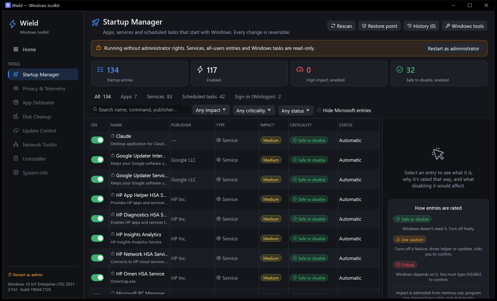

## Tools

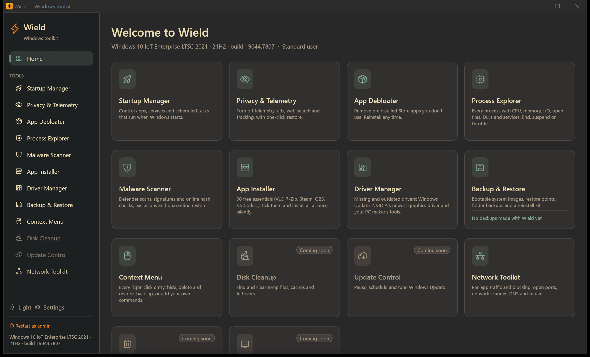

| Tool | Status |
|---|---|
| **Startup Manager** | ✅ Available |
| **Privacy & Telemetry** | ✅ Available |
| **App Debloater** | ✅ Available |
| **Network Toolkit** | ✅ Available |
| **Malware Scanner** | ✅ Available |
| **Process Explorer** | ✅ Available |
| **Backup & Restore** | ✅ Available |
| **Context Menu** | ✅ Available |
| **App Installer** | ✅ Available |
| **Driver Manager** | ✅ Available |
| Disk Cleanup, Update Control, Uninstaller, System Info | Planned |

### Startup Manager

Finds everything that starts with Windows:

- **Registry Run keys**: HKCU/HKLM `Run` (64- and 32-bit), plus `RunOnce` and policy `Run` (read-only)
- **Startup folders**: per-user and all-users, with shortcut targets resolved
- **Services**: every *Automatic* service, with delayed-start detection and the real `ServiceDll` for svchost services
- **Scheduled tasks**: every task with an *at startup* or *at log on* trigger
- **Winlogon**: `Shell`, `Userinit` and `AppInit_DLLs` (read-only; flagged if they differ from the Windows defaults)

Each entry is rated on two scales:

- **Criticality**: what breaks if you disable it.
  - 🟢 *Safe to disable*: Windows doesn't need it. Switches off with one click.
  - 🟠 *Use caution*: turns off a Windows feature, hardware helper or updates. You must tick a confirmation box.
  - 🔴 *Critical*: Windows depends on it (RPC, DHCP, DNS, audio, sign-in, Defender…). You must type `DISABLE` to confirm.

  Ratings come from a curated knowledge base (~150 services, Windows task folders, common apps), then vendor heuristics
  (security, GPU/audio/touchpad drivers, updaters). Entries whose program no longer exists are flagged as leftovers.
- **Impact** (High / Medium / Low): estimated from live memory use, program size, known heavy apps and start mode.
  Windows doesn't expose its own measured startup impact through any API.

**Safety**

- Disabling uses the same reversible mechanisms as Windows itself:
  - Run keys and Startup folders: Task Manager's `StartupApproved` flags. Nothing is deleted.
  - Services: start type is changed to *Manual* (recommended) or *Disabled*.
  - Scheduled tasks: the task's *Enabled* flag.
- Every change is recorded in `%LOCALAPPDATA%\Wield\startup-journal.json`. **History** can revert any change exactly.
- **Restore point** button creates a System Restore point before risky changes.
- Without administrator rights the app is read-only for machine-wide entries. Use *Restart as administrator* (UAC prompt).

### Privacy & Telemetry

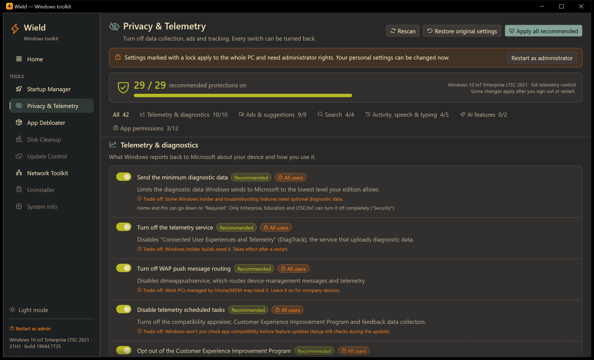

42 privacy settings in six groups, each shown with what it does and what you give up:

- **Telemetry & diagnostics**: diagnostic data level, the DiagTrack and dmwappushservice services, telemetry
  scheduled tasks, CEIP, app telemetry and inventory, Error Reporting, feedback prompts, tailored experiences,
  inking/typing data.
- **Ads & suggestions**: advertising ID, auto-installed promoted apps, tips, Settings and lock screen promotions,
  post-update welcome pages, File Explorer sync ads, consumer experiences.
- **Search**: Bing web results in Start, search highlights, cloud content search, Cortana.
- **Activity, speech & typing**: activity history, cross-device clipboard, online speech recognition,
  inking & typing personalization, app launch tracking.
- **AI features**: Recall snapshots (24H2+ Copilot+ PCs) and Windows Copilot.
- **App permissions**: block Store apps from account info, app diagnostics, location, camera, microphone,
  notifications, contacts, calendar, call history, email, messages and radios.

How it behaves:

- A **privacy score** counts how many of the 29 recommended protections are on. **Apply all recommended** turns
  them all on after showing you the list.
- It knows your edition. For example, it sets diagnostic data to *Security* on Enterprise/Education/LTSC and to
  *Required* on Home/Pro, and hides settings that don't exist on your build.
- Switching a setting off restores the Windows default. The first time Wield touches a value it saves the
  original to `%LOCALAPPDATA%\Wield\privacy-backup.json`, and **Restore original settings** puts everything back
  exactly as it was.
- Personal (HKCU) settings work without admin rights. All-users settings are marked with a lock.

### App Debloater

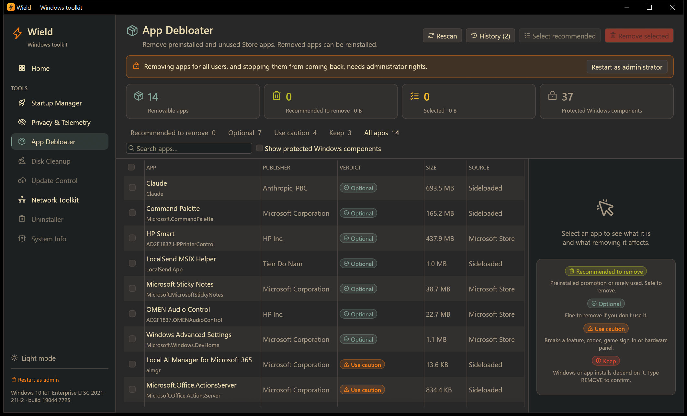

Lists every Store/MSIX app installed for your account, using the Windows `PackageManager` API rather than PowerShell.
Each app shows its publisher, size and source, and gets one of four verdicts:

- 🟢 **Recommended to remove**: preinstalled promotions and retired apps, such as Candy Crush, TikTok, Spotify, Disney+,
  Microsoft News, Tips, Solitaire, Clipchamp, Mixed Reality Portal, Movies & TV and Cortana.
- 🔵 **Optional**: fine to remove if you don't use it (Weather, Sticky Notes, Phone Link, Teams, Xbox Game Bar…).
- 🟠 **Use caution**: removing it breaks something, such as image/video codecs, Xbox sign-in for PC games,
  GPU/audio/touchpad control panels, Photos, Calculator or Snipping Tool. You must tick a confirmation box.
- 🔴 **Keep**: Microsoft Store, App Installer (winget), Windows Security, Edge and the app runtimes. You must type
  `REMOVE` to confirm.

Windows-protected system components are hidden by default and can't be selected.

- **Select recommended** checks all bloat in one click. The removal dialog lists every app and its verdict first.
- Remove for **your account only** (no admin needed), or as administrator for **all accounts**. As administrator you
  can also stop an app from reinstalling for new accounts and after feature updates.
- Every removal is logged to `%LOCALAPPDATA%\Wield\debloat-journal.json`. **History → Reinstall** re-registers the
  app from its files when Windows still has them, and otherwise opens its Microsoft Store page.

### Network Toolkit

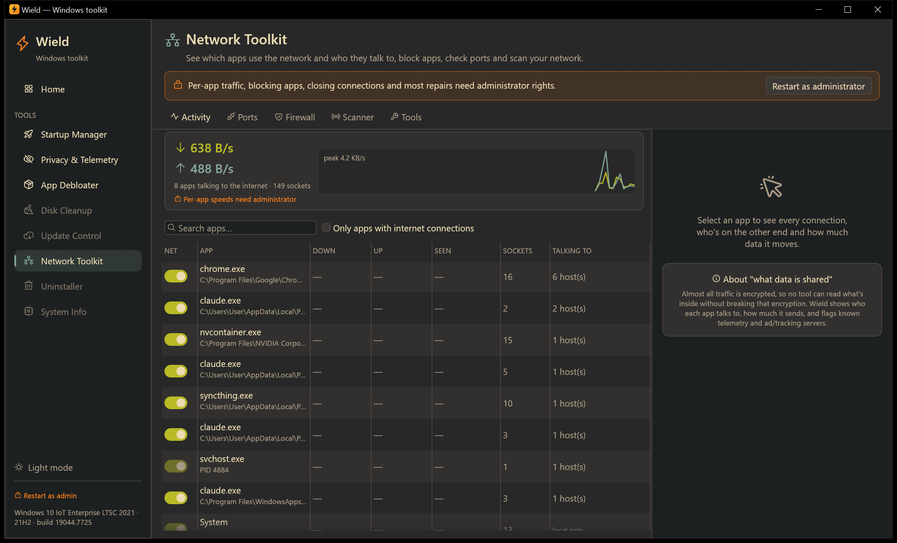

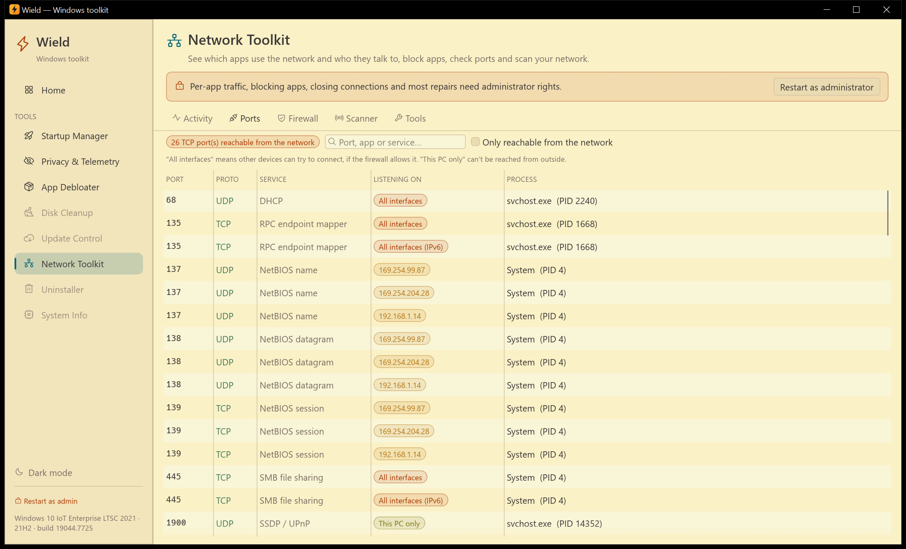

- **Activity**: every process with network sockets, plus a live whole-PC throughput graph.
  - As administrator, each app gets live download/upload speeds and the bytes it has moved since Wield started
    watching. These come from Windows' per-connection TCP statistics.
  - Select an app to see each connection: the host name (from the DNS cache, otherwise reverse DNS), port/service,
    state and speed.
  - Known **telemetry**, **ads/tracking** and **crash-report** servers are flagged.
  - Wield can't read *what* is sent: almost all traffic is encrypted. It shows *who* each app talks to and *how much*.
- **Block or allow any app** with its switch. This creates Windows Firewall rules that block the program in both
  directions. Blocking Windows' own programs (svchost.exe and others) asks for confirmation first. Individual IPv4
  connections can be closed.
- **Ports**: which process listens on which TCP/UDP port, the service name, and whether the port is reachable from the
  network or only from this PC.
- **Firewall**: your blocked-programs list (add any `.exe` with Browse…, toggle, remove) and **open inbound ports**
  (TCP/UDP, single ports, ranges or lists). Every rule is in the "Wield" group, so it's easy to find in `wf.msc`.
- **Scanner**:
  - Discovers devices on your LAN with a parallel ping sweep plus the ARP cache. Shows IP, name, MAC, latency, the
    router, this PC, and randomized private MACs.
  - Includes a TCP **port scanner** (common ports, 1-1024, or a custom list). Only scan devices you own or are
    allowed to test.
- **Tools**:
  - Adapter details, and **DNS presets** per adapter (Automatic, Cloudflare, Cloudflare malware-blocking, Google,
    Quad9, AdGuard).
  - Flush the DNS cache, ping, and show your public IP (asks api.ipify.org only when you click).
  - A **hosts-file domain blocker**. The original hosts file is backed up the first time Wield edits it.
  - **Repairs**: renew IP, clear ARP cache, reset Winsock, reset TCP/IP.

Per-app traffic, blocking, opening ports, closing connections, DNS changes and most repairs need administrator rights.

### Malware Scanner

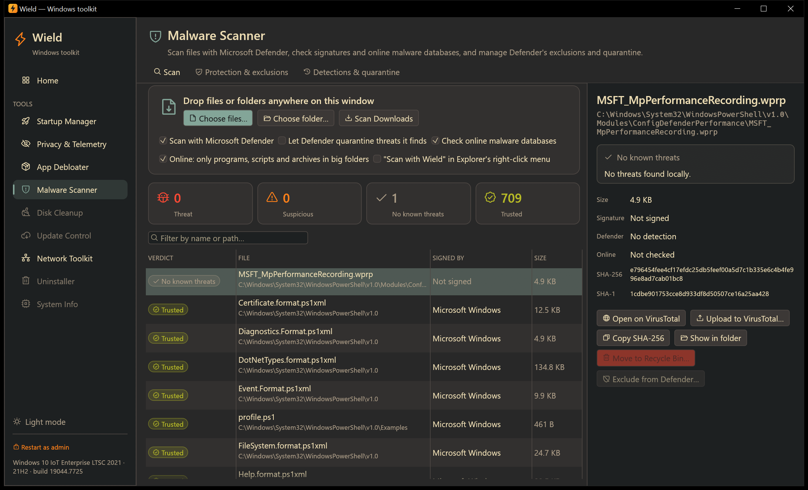

Scan any file or folder. Drop it on the window, use the pickers, or right-click it in Explorer and choose
**Scan with Wield** (an opt-in setting). It works without any account or API key:

- **Microsoft Defender scans it locally.** By default Defender only reports; tick the option to let it quarantine
  threats.
- **The digital signature is verified**, including Windows catalog signing, so system files show as signed by
  Microsoft Windows.
- **Download origin**: the URL Windows recorded when the file was downloaded.
- **Online reputation, by fingerprint only**:
  - SHA-1 is checked against the **Team Cymru Malware Hash Registry** (the percentage of antivirus engines that flag
    the file) and **CIRCL hashlookup** (known legitimate software, or known malicious).
  - File contents never leave the PC. For big folders, only programs, scripts and archives are checked online.
- Every file gets a verdict (**Threat**, **Suspicious**, **No known threats** or **Trusted**) with the reasons behind it.
- **Open on VirusTotal** shows the file's report in your browser by SHA-256, with no account needed.
  **Upload to VirusTotal…** warns that uploads are shared with security vendors, then opens the upload page for you
  to upload manually.
- Move files to the Recycle Bin (never files inside the Windows folder) or exclude them from Defender.

**Protection & exclusions**: Defender status (engine, real-time protection, definition age, Tamper Protection), update
definitions, and list/add/remove exclusions for files and folders, file types and processes.

**Detections & quarantine**: Defender's detection history with severity and outcome. Quarantined items can be
**restored**, optionally adding an exclusion first so Defender doesn't catch them again. High and severe threats
require typing `RESTORE`. Items Defender *removed* (rather than quarantined) can't be restored.

Exclusions, quarantine and restore need administrator rights. On work PCs, policy or Tamper Protection may block
exclusions.

### Process Explorer

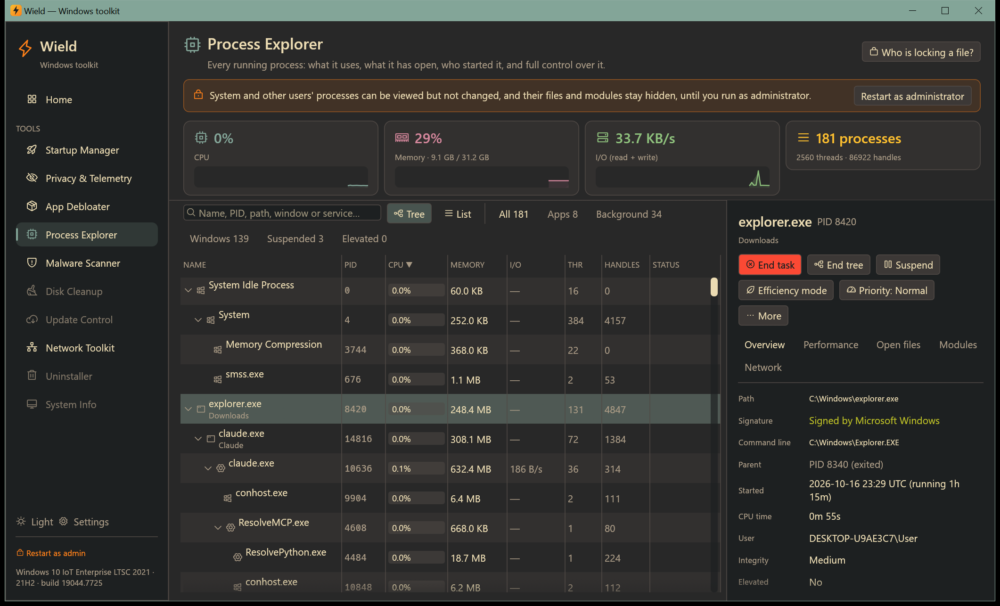

A Task Manager replacement that shows more:

- **Every process**, read in one native call (`NtQuerySystemInformation`). Protected system processes that can't be
  opened still show their memory, CPU time, threads, handles and I/O.
- **Live** CPU %, private memory, I/O rate, threads and handles, plus whole-PC CPU/memory/I/O graphs.
- **Tree view** of who started what (with PID reuse handled), or a sortable **list**. Filter by Apps, Background,
  Windows, Suspended or Elevated, and search by name, PID, path, window title or hosted service.
- **Details**, many of which Task Manager doesn't show:
  - full path, Authenticode signature/publisher, command line, parent and children;
  - start time and running time, total CPU time, user, integrity level, elevation, 32/64-bit;
  - priority, services hosted (for `svchost.exe`);
  - memory breakdown (private, working set, peaks, page faults, kernel pools) and I/O totals;
  - per-process CPU/memory graphs;
  - **open files and folders**, **loaded DLLs** (non-Windows ones highlighted) and **network connections**.
- **Control**:
  - **End task** / **End tree** (critical Windows processes are refused, and other Windows processes need confirming).
  - **Suspend / Resume** (freeze a process temporarily).
  - **Efficiency mode** (send it to the background: lowest priority plus power throttling, like Task Manager on
    Windows 11, and it works on Windows 10 too).
  - **Priority**, **CPU affinity** and **Restart**.
  - Open file location, **Scan with Malware Scanner**, **Block its network access**, search online, copy the
    command line.
- **Who is locking a file?** Pick a file or folder that says "in use by another program" and Wield lists the
  processes holding it (via the Restart Manager), with a button to end them.

### App Installer

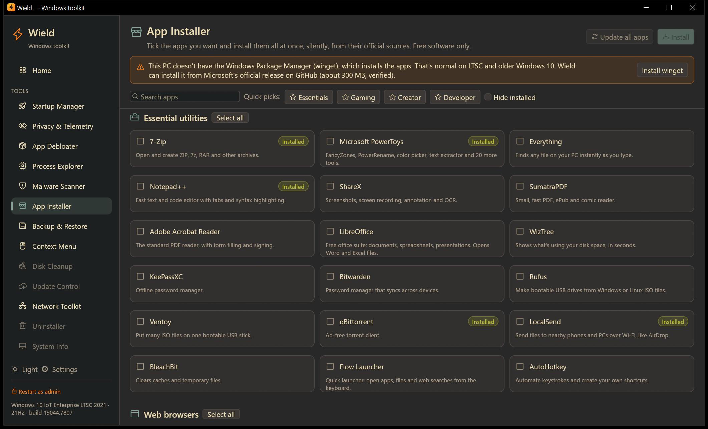

Tick apps and install them all at once, silently, through Microsoft's winget:

- 90 free essentials in nine categories: utilities, browsers, media, creative, games and launchers, game runtimes,
  hardware tools, chat and developer tools.
- Quick picks for Essentials, Gaming, Creator and Developer.
- Shows what's already installed, and updates every app with **Update all apps**.
- On LTSC and older Windows 10, installs winget itself from Microsoft's release, with checksums verified.

See the [manual](docs/manual/apps.md) for details.

### Driver Manager

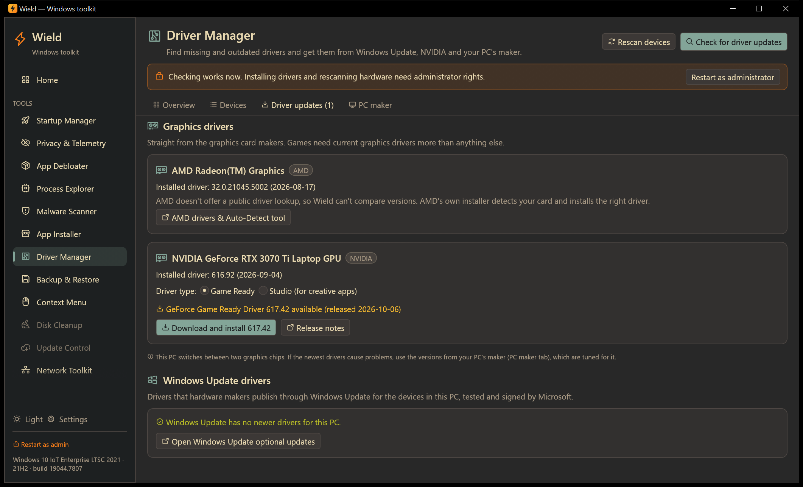

Finds devices without drivers and newer drivers, from official sources only:

- **Windows Update's driver catalog**: install the drivers it offers for your devices.
- **NVIDIA's driver service**: the newest Game Ready or Studio driver for your exact card, downloaded and checked
  for NVIDIA's signature before it runs. AMD and Intel link to their official tools.
- **Your PC maker**: detects HP, Dell, Lenovo, ASUS, MSI and others, opens your model's driver page and installs
  the maker's update tool.
- Every device with its driver version and date, problem codes explained, and installing drivers from a folder.

See the [manual](docs/manual/drivers.md) for details.

### Backup & Restore

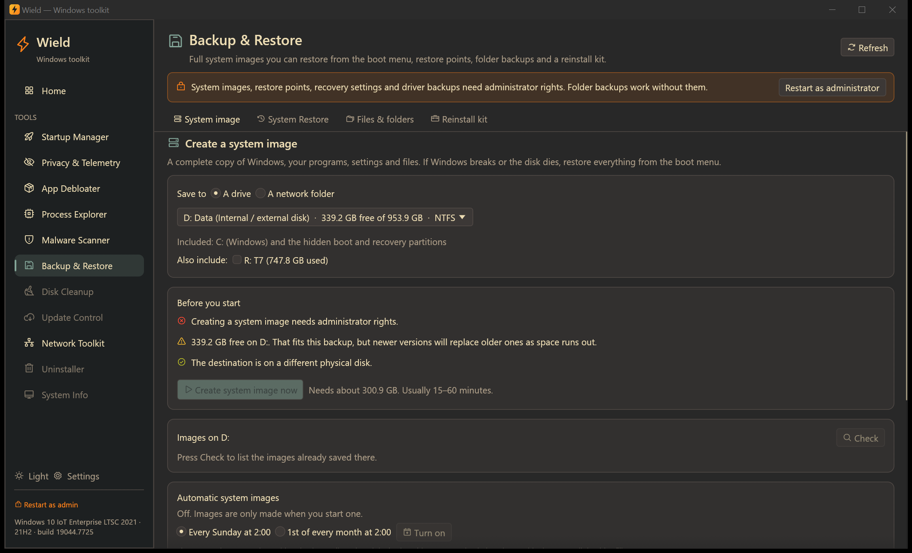

Get your PC back after a broken update, a bad driver, malware or a dead disk:

- **System image**: a complete copy of Windows, programs, settings and files, made with Windows' own `wbadmin`.
  - Save it to any internal or external drive, or to a network folder.
  - **Restore it from the boot menu**, even when Windows no longer starts: Troubleshoot → System Image Recovery.
  - **Pre-flight checks** run before you start. They block a destination that can't work (a USB stick, the drive
    being backed up, FAT32, too little space). They warn when the destination is on the same physical disk, when
    you're on battery, when the recovery environment is off, or when BitLocker is on.
  - Live progress with a Stop button, and a list of the images already on the drive, each marked as restorable
    from boot or not.
  - Weekly or monthly automatic images.
  - One click to **restart into the recovery options**, turn the Windows Recovery Environment on, or create a
    recovery USB.
- **System Restore**:
  - Turn protection on or off per drive and set how much space restore points may use.
  - **Create a restore point at any time**; Wield bypasses Windows' once-a-day limit.
  - List all restore points, **restore** one (it's applied at the next restart), or **delete** one or all.
  - Turn on a daily automatic restore point.
- **Files & folders**:
  - Incremental, resumable copies of Desktop, Documents, Pictures, Videos, Music, Downloads and any folders you
    add (robocopy), to any drive or network folder.
  - The backup is plain folders you can browse.
  - Optional mirror mode and a daily schedule.
  - **One-click restore** copies missing and older files back and never overwrites files that are newer on the PC.
- **Reinstall kit**: everything you need after a clean install, saved in one folder with a README:
  - all third-party **drivers**, with one-click reinstall;
  - **Wi-Fi networks** and their passwords;
  - the **list of installed apps**, plus a `winget import` file that reinstalls most of them at once;
  - your **BitLocker recovery key**;
  - the firmware **product key**.
- Every restore and delete is confirmed by typing a word (RESTORE / DELETE / RESTART), and every backup is
  logged with its full output.

### Context Menu

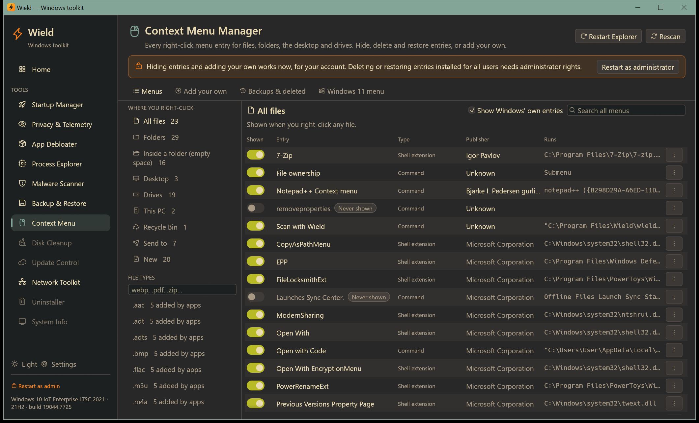

Take control of every right-click menu:

- **Finds every entry**, wherever you right-click:
  - files, every file type, folders, folder background, the desktop, drives, This PC and the Recycle Bin;
  - the **Send to** and **New** submenus;
  - commands, shell extensions, and Windows 11 app entries read from the apps' manifests.
- Shows each entry's publisher, what it runs, and where it's registered. Search across all menus at once.
- **Hide anything** with a switch, including Windows' own entries. Hiding never deletes; it works for your
  account without administrator rights and switches back just as easily.
- **Delete** entries added by other programs. An exact copy is saved first, and the **Deleted entries** list puts
  any of them back.
- **Shift-only**: move a command into the extended (Shift+right-click) menu.
- **Backups**: a complete snapshot of all menus, also made automatically the first time you open the tool and
  before every restore. Restore one with a single click, optionally removing entries added since.
- **Add your own**: run any program, `.bat`/`.cmd`, PowerShell script, VBScript or a raw command line.
  - Add it to chosen file types (e.g. **Convert to JPEG** on `.webp` files using your own batch file), all files,
    folders, the folder background, the desktop or drives.
  - Use single items or a **whole submenu**, with icon, position, Shift-only, and for you or all users.
  - Window options: show, keep open to read the output, or run hidden.
  - **Test** a command on a sample file before adding it. A preview shows the exact command Windows will run,
    and checks catch missing programs, unquoted paths and other mistakes.
- **Windows 11**: switch back to the classic full menu (and back again), with Explorer restarted for you.

## Updates

Wield checks GitHub for a new release when it starts (at most every 12 hours). You can turn this off in
**Settings**.

- When an update is available, the sidebar shows **Update to vX.Y.Z**. **Update now** downloads it, verifies it
  against the release's published SHA-256 checksum, installs it and reopens Wield.
- Turn on **Download updates automatically** to have updates download in the background and install when you close
  Wield.
- Installed copies update by running the new installer silently. Portable copies replace their own `.exe`.
- **Skip this version** stops the reminder for that release.

## Build

Requires the Rust MSVC toolchain.

```bash
cargo build --release
```

The binary is `target/release/wield.exe`. To build the installer as well, install
[Inno Setup 6](https://jrsoftware.org/isinfo.php) and run `installer\build.ps1 -Version <x.y.z>`; it writes
`dist\wield-v<x.y.z>-setup.exe`. CI builds the installer on every push and tests a silent install and uninstall.
Command-line options (`--tool`, `--tab`, `--pid`, `--scan`) are listed in the
[manual](docs/manual/README.md#command-line-options).

```bash
cargo test
cargo test live_scan -- --ignored --nocapture
```

The second command scans the real machine and prints every entry with its rating.

## Releases

CI builds and tests every push and pull request. To publish a release, push a version tag:

```bash
git tag v0.1.0
```

```bash
git push origin v0.1.0
```

The Release workflow builds the portable exe and the installer, tests the installer, and attaches both with SHA-256 checksums to a GitHub Release.
