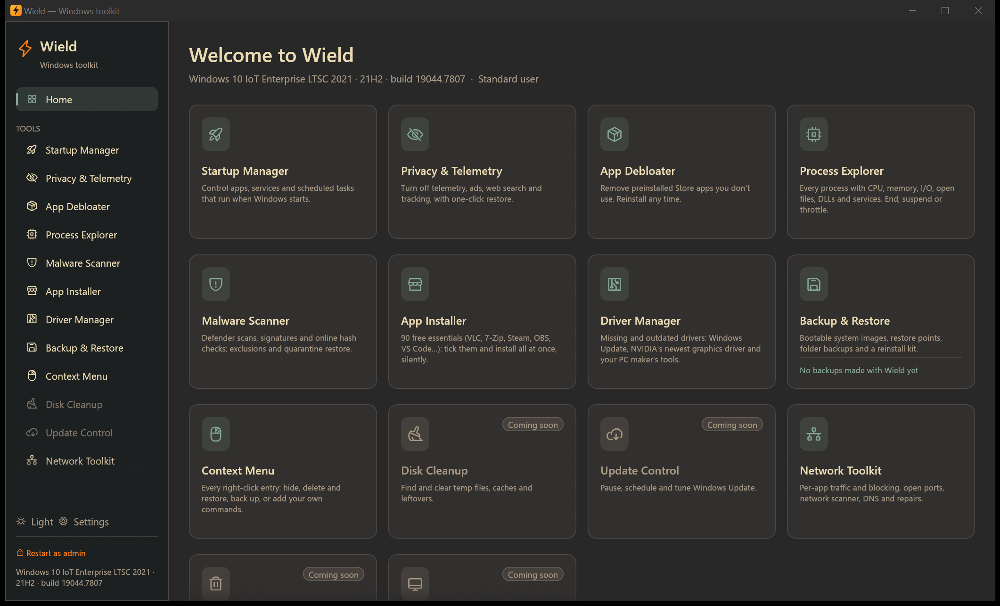

# Wield user manual

Wield is a Windows toolkit for Windows 10 and Windows 11 (Home, Pro, Enterprise, Education, LTSC and IoT). Its tools
let you install essential apps in one click, fix and update drivers, control what starts with Windows, protect your privacy, remove bloat, watch and control the network, scan
for malware, manage processes, back up and restore the whole PC, and edit the right-click menus.

This manual explains every screen and every button. Each tool has its own page.

## Contents

- [Getting started](#getting-started)
  - [Installing](#installing)
  - [The window](#the-window)
  - [Administrator rights](#administrator-rights)
  - [How Wield keeps you safe](#how-wield-keeps-you-safe)
- Tools
  - [Startup Manager](startup.md): apps, services and tasks that start with Windows
  - [Privacy & Telemetry](privacy.md): turn off data collection, ads and tracking
  - [App Debloater](debloat.md): remove preinstalled Store apps
  - [Process Explorer](processes.md): every running process, with full control
  - [Malware Scanner](malware.md): Defender scans, signatures, online reputation, exclusions and quarantine
  - [Network Toolkit](network.md): per-app traffic, blocking, ports, firewall, LAN scanner, DNS and repairs
  - [App Installer](apps.md): install 90 free essential apps at once, silently
  - [Driver Manager](drivers.md): missing and outdated drivers from Windows Update, NVIDIA and your PC's maker
  - [Backup & Restore](backup.md): system images, System Restore, folder backups and a reinstall kit
  - [Context Menu](context-menu.md): every right-click entry; hide, delete, back up, add your own
- [Settings and updates](settings.md)
- [Where Wield keeps its data](#where-wield-keeps-its-data)
- [Command-line options](#command-line-options)
- [Troubleshooting](#troubleshooting)

## Getting started

### Installing

Download Wield from the [Releases page](https://github.com/plaintextlab/wield/releases). There are two kinds:

| File | What it is |
|---|---|
| `wield-vX.Y.Z-setup.exe` | **Installer.** Installs for your account without admin rights, or for all users. Adds a Start menu entry, an optional desktop shortcut and an uninstaller in Settings → Apps. It can also add **Scan with Wield** to Explorer's right-click menu. |
| `wield-vX.Y.Z-windows-x64.exe` | **Portable.** One file, nothing to install. Run it from any folder or a USB stick. |

Both kinds update themselves (see [Settings and updates](settings.md)). Uninstalling keeps your Wield data (undo
histories and backups) in case you reinstall.

Windows SmartScreen may warn about a new download. Choose **More info → Run anyway** if you trust the source.
Each release also publishes a `.sha256` checksum for every file.

### The window

- **Sidebar (left).** **Home** shows every tool as a card. Below it is the list of tools; greyed-out tools are planned
  but not built yet.
- **Home cards** show a live one-line status for each tool, for example how many startup entries are enabled or when
  you last made a backup. Click a card to open the tool.
- **Bottom of the sidebar:**
  - **Light / Dark** switches between the Gruvbox light and dark themes. Your choice is remembered.
  - **Settings** opens updates, appearance, Explorer integration and data locations.
  - **Restart as admin** (when you're not an administrator) or the green **Administrator** label.
  - Your Windows edition, release and build.
  - **Update to vX.Y.Z** appears when a new version is available.
- **Messages** about finished actions pop up in the bottom-right corner (green for success, red for problems).

### Administrator rights

Wield starts as a normal user. Everything that only affects your account works straight away. Changes that affect
the whole PC need administrator rights, for example:

- services, all-users startup entries and scheduled tasks;
- PC-wide privacy settings;
- removing apps for all accounts;
- firewall rules, per-app traffic and repairs;
- Defender exclusions and quarantine;
- system images, restore points and recovery settings;
- deleting all-users right-click entries.

Screens that need it show an orange banner with a **Restart as administrator** button. Wield then reopens with a
Windows UAC prompt. Settings that need admin are marked with a lock icon.

### How Wield keeps you safe

Every tool follows the same rules:

- **Nothing changes without you clicking.** Opening a tool only reads.
- **Everything can be undone.** Disabling uses Windows' own reversible switches rather than deleting. When something
  must be deleted, an exact copy is saved first and can be restored from inside Wield.
- **Risk is shown up front.** Entries are rated (green / orange / red). Risky actions ask for confirmation, and
  dangerous ones make you type a word such as `DISABLE`, `REMOVE`, `RESTORE` or `DELETE`.
- **Checks before big jobs.** Backups, custom menu entries and similar tasks list their checks first and refuse to
  start when something would fail.
- **No hidden network traffic.** Wield sends nothing on its own except the update check, which you can turn off.
  Online lookups (malware reputation, public IP) only happen when you ask for them, and only fingerprints are sent,
  never your files.

## Where Wield keeps its data

Everything lives in `%LOCALAPPDATA%\Wield` (paste that into Explorer's address bar to open it):

| File or folder | Used by |
|---|---|
| `settings.json` | Theme and update preferences |
| `startup-journal.json` | Startup Manager change history (undo) |
| `privacy-backup.json` | Original values of every privacy setting Wield changed |
| `debloat-journal.json` | Removed apps, for reinstalling |
| `backup-history.json`, `backup-logs\` | Backup & Restore history and the full output of every backup |
| `restore-protection.json` | System Protection state as Wield last set it |
| `folder-backup.cmd` | The script run by the scheduled folder backup |
| `ctxmenu\` | Context Menu backups, deleted entries, hidden Send To items and your own entries |
| `app-installs\` | App Installer logs |

The hosts file backup is next to the hosts file: `C:\Windows\System32\drivers\etc\hosts.wield-backup`.

## Command-line options

| Option | Effect |
|---|---|
| `--tool <name>` | Opens a tool: `startup`, `privacy`, `debloat`, `network`, `malware`, `processes`, `apps`, `drivers`, `backup`, `contextmenu` or `settings` |
| `--tab <name>` | Opens a tab. Network Toolkit: `activity`, `ports`, `firewall`, `scanner`, `tools`. Malware Scanner: `scan`, `protection`, `detections`. Backup & Restore: `image`, `restore`, `files`, `kit`. Context Menu: `menus`, `add`, `backups`, `win11`. Driver Manager: `overview`, `devices`, `problems`, `thirdparty`, `updates` (starts the check), `maker` |
| `--pid <number>` | Selects that process in Process Explorer |
| `--scan <file or folder>` | Opens the Malware Scanner and starts scanning it |
| `--run-hidden <command>` | Runs a command without a window, then exits. Used by right-click entries set to "Run hidden". |

Example: `wield.exe --tool network --tab firewall`

## Troubleshooting

**A switch or button is greyed out.** Hover over it: the tooltip says why. Usually it needs administrator rights
(use **Restart as administrator**) or another job is still running.

**A change didn't take effect.**

- Shell extensions and the Windows 11 menu setting need Explorer restarted. The Context Menu tool has a
  **Restart Explorer** button.
- Some network repairs need a Windows restart.
- System Restore is applied while Windows restarts.

**Windows blocks a change on a work PC.** Group Policy or Tamper Protection can lock settings, firewall rules and
Defender exclusions. Wield shows Windows' error message; ask your administrator.

**I want to undo something.**

| Tool | Where to undo |
|---|---|
| Startup Manager | **Undo previous changes** |
| Privacy & Telemetry | **Restore original settings** |
| App Debloater | **Removed apps → Reinstall** |
| Context Menu | **Backups & deleted** |
| Firewall rules | Switch off or remove them in **Network Toolkit → Firewall** |

You can also create a restore point before big changes ([Backup & Restore → System Restore](backup.md#system-restore)).

**Reporting a problem.** Use **Settings → Report a problem**, or open an issue on
[GitHub](https://github.com/plaintextlab/wield/issues). Include your Windows version from the bottom of the sidebar.
