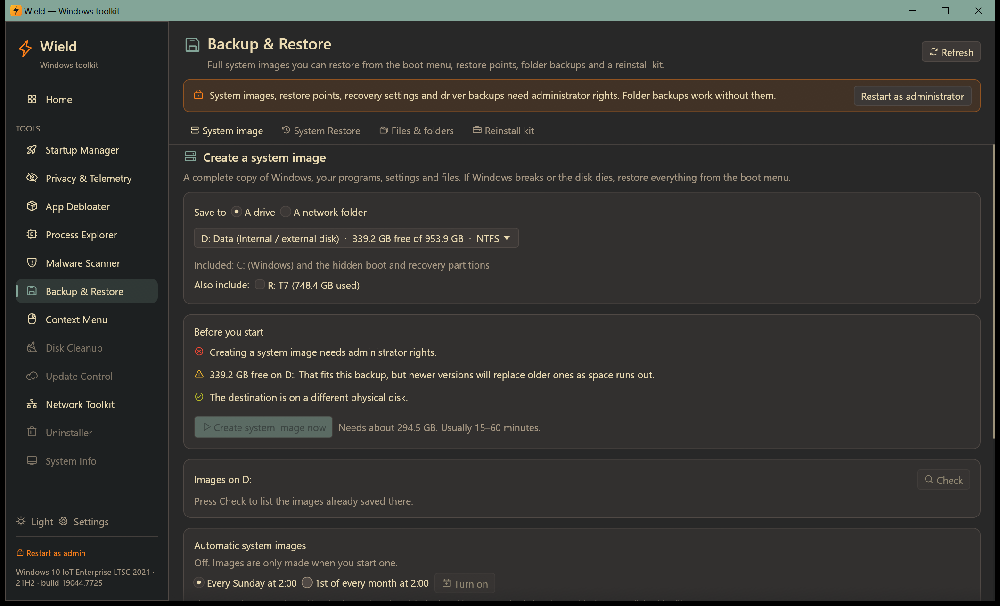
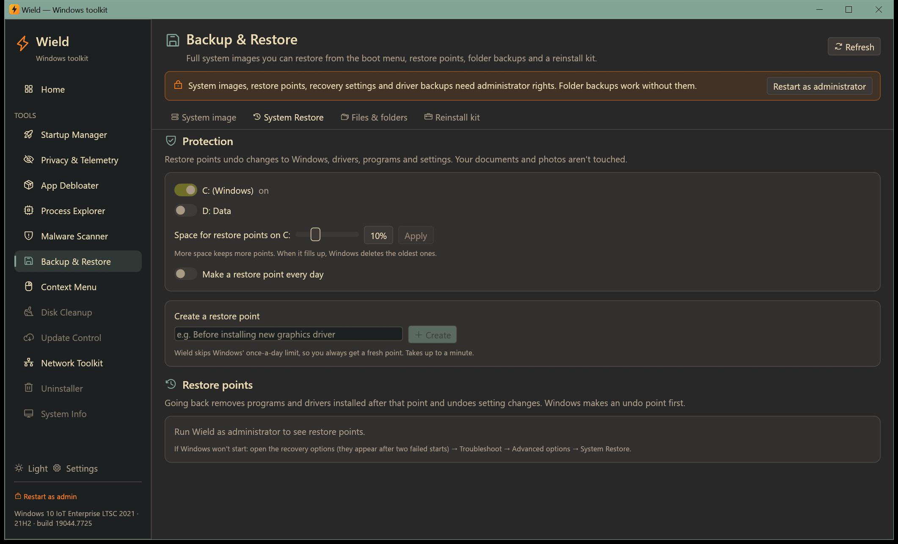
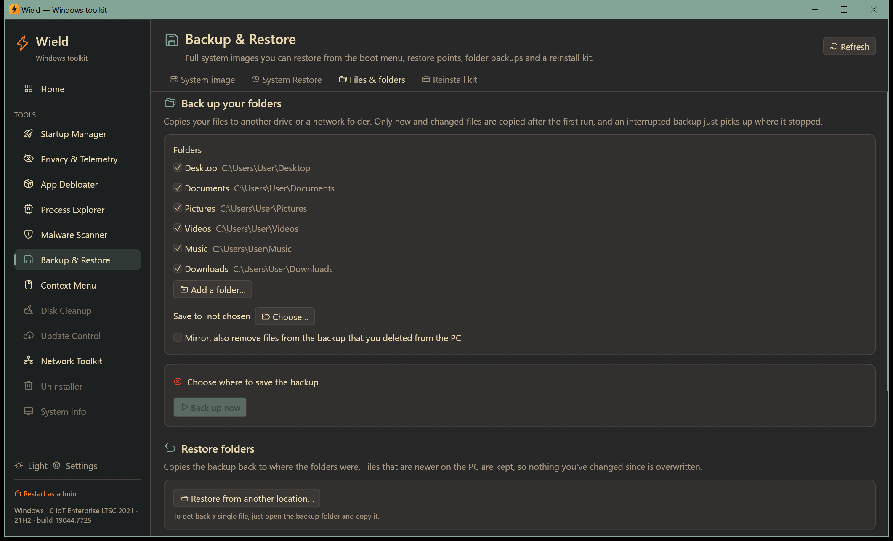
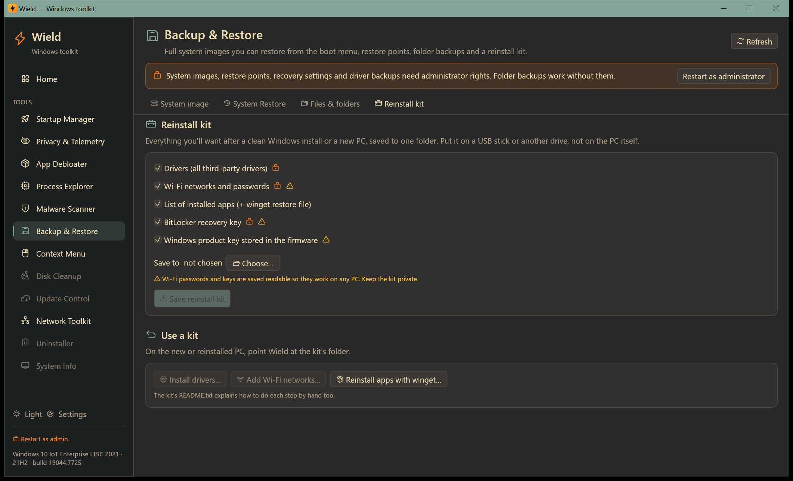

# Backup & Restore

[← Manual](README.md)

Get your PC back after a broken update, a bad driver, malware or a dead disk. Four tabs cover four kinds of
protection:

| Tab | Protects against | Restores |
|---|---|---|
| [System image](#system-image) | Dead disk, Windows that won't start, ransomware | Everything: Windows, programs, settings and files |
| [System Restore](#system-restore) | Bad update, driver or program install | Windows, drivers, programs and settings (not your files) |
| [Files & folders](#files--folders) | Deleted or damaged files | Your documents, photos and other folders |
| [Reinstall kit](#reinstall-kit) | Starting over on a clean Windows or a new PC | Drivers, Wi-Fi, app list, keys |

A good routine: a **daily restore point**, a **daily folder backup** and a **weekly system image** to an external
drive.

Restores and deletes always ask you to type a word (`RESTORE`, `DELETE` or `RESTART`). Every backup is logged with
its full output; the **History** at the bottom of a tab opens the log.

## System image

A complete copy of every partition Windows needs to start (Windows, the boot partition and the recovery partition),
made with Windows' built-in `wbadmin`. It can be restored from the boot menu even when Windows no longer starts.
Needs administrator rights.

### Making an image

1. **Save to**:
   - **A drive**: an internal disk or an external USB hard disk/SSD. Wield preselects the largest drive on another
     physical disk.
   - **A network folder**: `\\server\share`, with a user name and password if needed. The password is only passed to
     Windows Backup for this run and isn't stored.
2. **Also include** other drives if you want them in the image. Windows (C:) and the hidden boot and recovery
   partitions are always included.
3. Read **Before you start**:
   - ❌ Red items block the backup, for example:
     - a USB flash stick (Windows can't store images on those);
     - the drive being backed up;
     - a non-NTFS drive;
     - not enough space;
     - a mapped network drive letter (use the `\\server\share` form instead);
     - no administrator rights.
   - ⚠️ Yellow items are warnings, for example:
     - the destination is on the same physical disk as Windows;
     - you're on battery;
     - the recovery environment is off;
     - BitLocker is on (the image is stored unencrypted);
     - free space will run out after a few images.
   - ✅ Green items confirm what's fine.
4. Click **Create system image now**. The estimate tells you how much space it needs; it usually takes 15–60
   minutes.
5. The progress card shows each volume's percentage and the live output. You can keep using the PC. **Stop**
   cancels; a cancelled image can't be restored.

**Images on [drive]** → **Check** lists the images already saved there. Each is marked **Restorable from boot** or
**Files only**.

### Automatic images

Choose **Every Sunday at 2:00** or **1st of every month at 2:00**, then **Turn on**. The PC must be on (or asleep
with wake timers allowed) and the drive connected. Windows keeps older images until the drive fills up, then
replaces the oldest. Automatic images need a local drive.

### Restoring an image

Restoring replaces everything on the PC with the image. Files created since the image was made are lost, so copy
them somewhere first.

1. Connect the drive holding the image.
2. Click **Restart to recovery options…** and type `RESTART`. The PC restarts in 5 seconds. If Windows doesn't start
   at all, the recovery options open by themselves after two failed starts. You can also boot from a recovery USB
   or a Windows install USB and choose **Repair your computer**.
3. Choose **Troubleshoot → Advanced options → See more recovery options → System Image Recovery**.
4. Pick the image (the newest is preselected) and follow the steps. Leave **Format and repartition disks** off
   unless you're restoring to a new disk.

The **Recovery environment** badge must be **on** for step 2. If it's off, click **Turn it on**. **Create a recovery
USB drive** opens Windows' Recovery Drive tool: make one, so you can restore even if the disk's recovery partition is
gone. If BitLocker is on, save your recovery key first (see [Reinstall kit](#reinstall-kit)).

## System Restore

Restore points undo changes to Windows, drivers, programs and settings. Your documents and photos aren't touched.
Needs administrator rights.

### Protection

- **The switch per drive** turns System Protection on or off. Without protection on C: there are no restore points,
  and a red banner says so. Turning it on also gives it a sensible amount of space.
- **Space for restore points on C:**: drag the slider (2–30% of the drive) and click **Apply**. More space keeps
  more points; when it fills up, Windows deletes the oldest.
- **Make a restore point every day**: a scheduled task creates one daily at 12:00.

### Creating a restore point

Type a description (for example *Before installing new graphics driver*) and click **Create**. Wield skips Windows'
once-a-day limit, so you always get a fresh point. It takes up to a minute.

### Restoring

The list shows every restore point with its date, description and type:

- Windows Update;
- app install or removal;
- driver install;
- created by Wield;
- manual / settings.

1. Click **Restore** on a point and type `RESTORE`.
2. Choose **Restart now**, or **Later** to restore at the next restart.

Programs and drivers installed after that point are removed, and later setting changes are undone. Windows makes an
undo point first, so a restore can itself be reversed. The restore takes 10–30 minutes during the restart; don't
turn the PC off.

**Delete** (🗑) removes one point, and **Delete all restore points** removes every point on C:. Both need `DELETE`.
**Open Windows System Restore** opens Windows' own wizard, which includes *Scan for affected programs*.

If Windows won't start, the recovery options (after two failed starts) offer **Troubleshoot → Advanced options →
System Restore**.

## Files & folders

Copies your folders to another drive or a network folder with Windows' `robocopy`. This works without administrator
rights.

### Backing up

1. **Folders**: Desktop, Documents, Pictures, Videos, Music and Downloads are listed (following OneDrive or
   redirected locations). Untick what you don't want. **Add a folder…** adds any other folder.
2. **Save to**: **Choose…** a drive or folder. The backup goes into `WieldBackup\<PC name>\` there, as plain
   folders you can browse.
3. **Mirror** (optional): also removes files from the backup that you deleted on the PC. Leave it off to keep
   deleted files in the backup, which is safer.
4. Read the checks:
   - a destination inside a backed-up folder is blocked;
   - the same disk as your files gets a warning;
   - the free space is shown;
   - "A previous backup is there" means only changes will be copied.
5. Click **Back up now**. After the first run only new and changed files are copied, and an interrupted backup
   continues where it stopped.

**Back up daily at 13:00** schedules it (it runs while you're signed in). **Stop daily backup** removes the
schedule. **Open backup folder** shows the backup in Explorer.

### Restoring

- **Restore from [location]** copies the backup back to where each folder was. Missing and older files are copied
  back; **files that are newer on the PC are kept**, so nothing you changed since is overwritten.
- **Restore from another location…** restores from a backup elsewhere, for example on a new PC: choose the drive or
  folder that contains `WieldBackup`.
- To get back a single file, just open the backup folder and copy it.

## Reinstall kit

Everything you'll want after a clean Windows install or on a new PC, saved to one folder
(`WieldBackup\<PC name>\Reinstall kit`) with a `README.txt` that explains each part. Save it to a USB stick or
another drive, not the PC itself.

| Part | Saved as | Needs admin |
|---|---|---|
| **Drivers**: all third-party drivers | `Drivers\` | Yes |
| **Wi-Fi networks and passwords** | `WiFi\*.xml` | Yes |
| **Installed apps** | `installed-apps.csv`, plus `winget-apps.json` | No |
| **BitLocker recovery key** | `BitLocker recovery key C.txt` | Yes |
| **Windows product key** stored in the firmware (if any) | `Windows product key.txt` | No |

Wi-Fi passwords and keys are saved readable so they work on any PC, so keep the kit private.

### Using a kit

On the new or reinstalled PC, open Wield and use **Use a kit**:

- **Install drivers…** installs every driver in the kit's `Drivers` folder (administrator).
- **Add Wi-Fi networks…** imports every saved network (administrator).
- **Reinstall apps with winget…** opens a window running `winget import`, which reinstalls most apps at once.

Choose the kit folder when asked. The README in the kit also explains how to do each step by hand.
