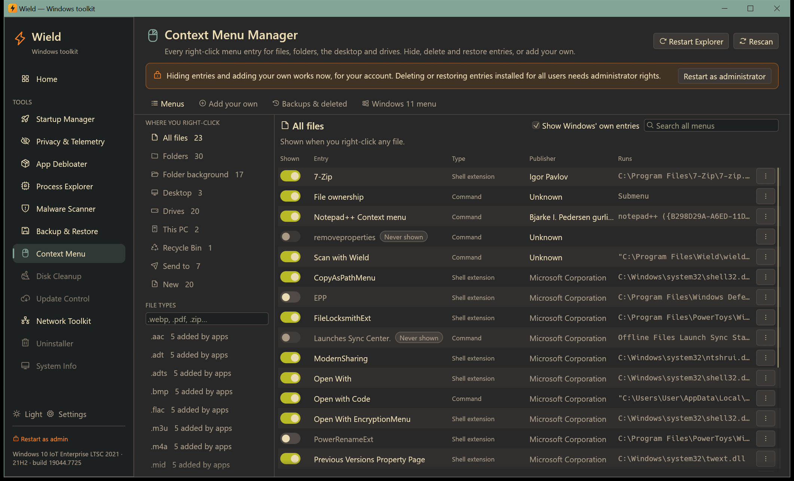
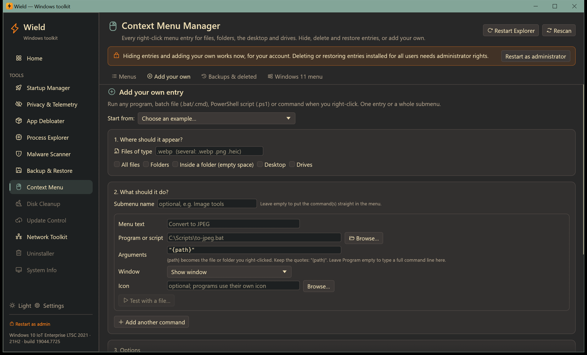
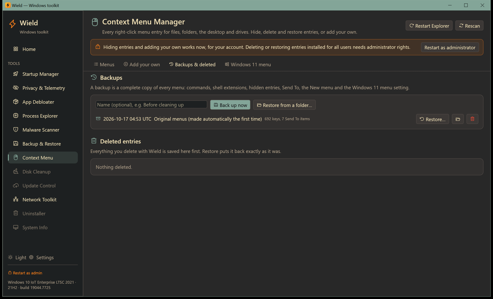
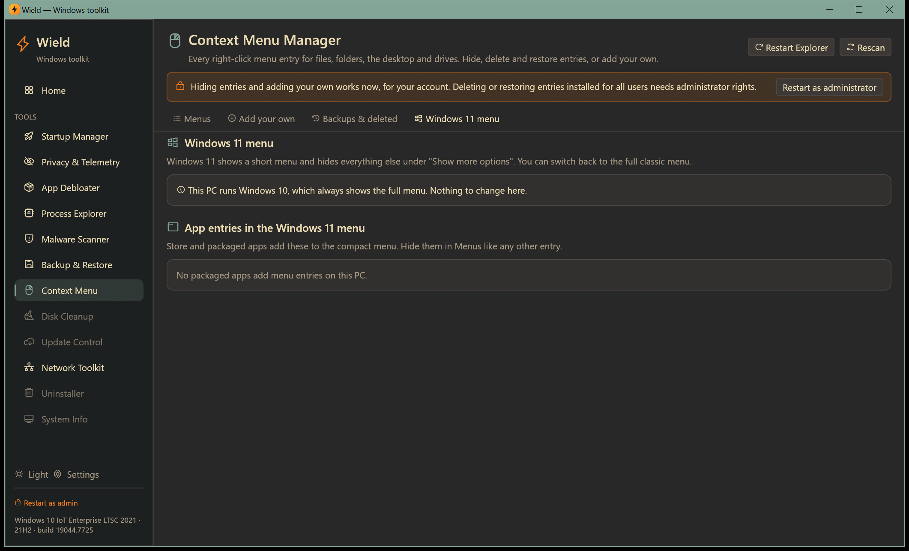

# Context Menu

[← Manual](README.md)

Every entry in every right-click menu: see what each one is, hide or delete the ones you don't want, back everything
up, and add your own commands.

## Menus

### Finding entries

The left side lists **where you right-click**, with the number of entries for each:

| Place | When it appears |
|---|---|
| **All files** | Right-clicking any file |
| **Folders** | Right-clicking a folder |
| **Folder background** | Right-clicking empty space inside an Explorer window |
| **Desktop** | Right-clicking empty space on the desktop |
| **Drives** | Right-clicking a drive in This PC |
| **This PC**, **Recycle Bin** | Right-clicking those icons |
| **Send to** | The *Send to* submenu |
| **New** | The *New* submenu (right-click empty space → New) |

**File types** lists types whose menus have extra entries added by apps. Type an extension (`.pdf`, `.webp`…) to
find any type. A file type shows everything you see when right-clicking such a file, including the *All files*
entries.

**Search all menus** (top right) searches every menu at once, by name, command, publisher or key.
Untick **Show Windows' own entries** to see only what other programs added.

### What each column means

- **Shown**: the switch.
- **Entry**: the menu text, with badges:
  - **Yours**: added with Wield;
  - **Shift**: only shown with Shift+right-click;
  - **Never shown**: registered for programs to use, never displayed by Windows.
- **Type**:
  - **Command**: runs a program;
  - **Shell extension**: a plug-in DLL such as 7-Zip;
  - **App (Windows 11 menu)**: from a Store/packaged app;
  - **Send to**;
  - **New item**.
- **Publisher**: from the program's signature or version info. *Windows* for built-in entries.
- **Runs**: the command or DLL. Hover for full details: registry key, CLSID, and whether it's installed for all
  users (HKLM) or just you (HKCU).

### Hiding, deleting and more

- **The switch hides or shows an entry.** Hiding never deletes anything, works for Windows' own entries too, and
  needs no administrator rights: it applies to your account. Switch it back on at any time.
  - Hiding a **shell extension** blocks it by its ID, so it disappears from every menu it was in. Explorer must
    restart to pick this up; a banner offers **Restart Explorer now**.
  - Hidden **Send to** items are moved to Wield's folder and moved back when shown.
- **The ⋯ button** on each row offers:
  - **Only with Shift+right-click** / **Show without Shift**: moves a command to the extended menu;
  - **Delete…**: for entries added by other programs. An exact copy is saved first; restore it any time from
    **Backups & deleted**. Windows' own entries can only be hidden. Deleting an entry installed for all users
    needs administrator rights;
  - **Open in Registry Editor**, **Open file location** and **Copy details**.
- **New** menu items can't be hidden, only removed with **Delete…** (and restored later).
- **Rescan** reads all menus again. **Restart Explorer** applies changes Explorer has cached; open Explorer windows
  close and the taskbar reloads for a moment.

## Add your own

Add any program, batch file (`.bat`/`.cmd`), PowerShell script (`.ps1`), VBScript or command line to a right-click
menu: as a single entry, or a whole submenu with several commands.

**Start from** offers ready-made examples:

- **Run my script on a file type** (e.g. convert .webp to JPEG);
- **Open PowerShell here**;
- **Open Command Prompt here**;
- **Open with Notepad**;
- **Copy full path**.

### 1. Where should it appear?

- **Files of type**: one or more extensions, for example `.webp` or `.webp .png .heic`.
- **All files**, **Folders**, **Inside a folder (empty space)**, **Desktop**, **Drives**.

Tick as many as you like.

### 2. What should it do?

- **Submenu name** (optional): groups the commands under one menu item, such as *Image tools*. Leave it empty to put
  the commands straight into the menu. A submenu can have its own icon.
- For each command:
  - **Menu text**: what you'll see, e.g. *Convert to JPEG*.
  - **Program or script**: **Browse…** to pick the `.exe`, `.bat`, `.cmd`, `.ps1` or `.vbs`. Leave it empty to type
    a full command line in Arguments.
  - **Arguments**: `{path}` becomes the file or folder you right-clicked. Keep the quotes, `"{path}"`, so paths with
    spaces work. For *Folder background* and *Desktop*, `{path}` is the folder you're in.
  - **Window**:
    - **Show window**: shows the program's window (or a console for scripts) and closes when done;
    - **Keep window open after it finishes**: so you can read a script's output or errors;
    - **Run hidden (no window)**: runs it silently, through Wield.
  - **Icon** (optional): a program, `.dll` or `.ico`. Programs use their own icon automatically.
  - **Test with a file…** (or **folder…**): runs the command right now on a file you choose, exactly as the menu
    will.
- **Add another command** adds more commands (to the submenu, or as separate entries).

### 3. Options

- **Only show with Shift+right-click**.
- **Position**: Normal, Top or Bottom of the menu.
- **For all users on this PC** (needs administrator rights). Otherwise the entry is for your account only.

### 4. Check and save

Wield checks everything before saving:

- a missing program;
- a missing `{path}` or `{path}` without quotes;
- invalid file types;
- duplicate names;
- missing administrator rights.

Red items must be fixed first. **Windows will run:** shows the exact command line that will be registered. Click
**Add to menu**.

**Your entries** lists everything you added. **Edit** loads one back into the form (**Save changes** replaces it);
🗑 removes it from the menu. Your script itself is never touched.

### Example: "Convert to JPEG" for .webp images

You have `C:\Scripts\to-jpeg.bat`, which converts the file passed to it.

1. **Start from → Run my script on a file type**. **Files of type** is already `.webp`.
2. **Menu text**: `Convert to JPEG`.
3. **Program or script**: **Browse…** → `C:\Scripts\to-jpeg.bat`.
4. **Arguments**: `"{path}"` (already filled in).
5. **Window**: *Keep window open after it finishes* while you're testing; switch to *Show window* or *Run hidden*
   once it works.
6. **Test with a file…** → pick a `.webp` file and check the result.
7. **Add to menu**. Right-click any `.webp` file: **Convert to JPEG** is there.

On Windows 11 it appears under **Show more options** unless you switch to the classic menu (see below).

To build a whole menu, enter a **Submenu name** such as *Image tools* and add more commands: *Convert to PNG*,
*Resize to 50%*, and so on.

Entries for file types are added to Windows' per-type list (`SystemFileAssociations`), so they keep working when you
change which app opens that type.

## Backups & deleted

- **Backups** are complete snapshots of every menu:
  - commands and shell extensions for every place and file type;
  - hidden entries;
  - Send To items and the New menu;
  - the Windows 11 menu setting.

  Wield makes one automatically **the first time you open the tool**, and again before every restore.
  - **Back up now**, optionally with a name such as *Before cleaning up*.
  - **Restore…** (type `RESTORE`) puts every menu back as it was: deleted entries return and entries hidden since are
    shown again. Tick **Also remove entries added after this backup** to make the menus exactly as in the backup.
    Without administrator rights, all-users entries are skipped (you're told how many).
  - 📁 shows the backup folder. Copy it elsewhere to keep it; **Restore from a folder…** restores a copied backup.
  - 🗑 deletes a backup.
- **Deleted entries** lists everything you deleted with Wield. **Restore** puts it back exactly as it was. **✕**
  removes it from the list (the entry stays deleted).

## Windows 11 menu

Windows 11 shows a short menu and hides the rest under **Show more options**.

- **Use the classic full menu** brings back the Windows 10 style menu with every entry. **Back to the Windows 11
  menu** switches back.
- This applies to your account only. Wield restarts Explorer for you.
- Shift+right-click always opens the classic menu too.

The tab also lists **App entries in the Windows 11 menu** added by Store and packaged apps. Hide them in **Menus**
like any other entry. On Windows 10 this tab just confirms that the full menu is always used.
