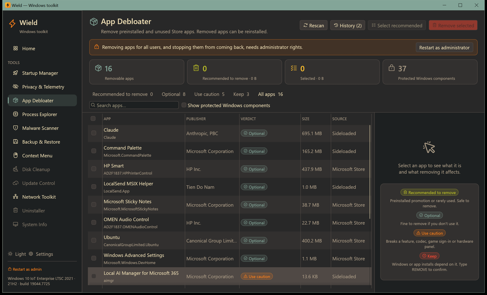

# App Debloater

[← Manual](README.md)

Remove preinstalled and unused Microsoft Store apps. Every removal is logged, and removed apps can be reinstalled.

## The list

Every Store (MSIX) app installed for your account is listed with its publisher, size and source. Each one gets a
verdict:

| Verdict | Meaning | To remove |
|---|---|---|
| 🟢 **Recommended to remove** | Preinstalled promotions and retired apps: Candy Crush, TikTok, Spotify, Disney+, Microsoft News, Tips, Solitaire, Clipchamp, Mixed Reality Portal, Movies & TV, Cortana… | One click |
| 🔵 **Optional** | Fine to remove if you don't use it: Weather, Sticky Notes, Phone Link, Teams, Xbox Game Bar… | One click |
| 🟠 **Use caution** | Removing it breaks something: image/video codecs, Xbox sign-in for PC games, GPU/audio/touchpad control panels, Photos, Calculator, Snipping Tool… | Tick "I understand what these apps do" |
| 🔴 **Keep** | Windows or app installs depend on it: Microsoft Store, App Installer (winget), Windows Security, Edge, app runtimes | Type `REMOVE` |

Windows' own protected components are hidden. Tick **Show protected Windows components** to see them; they
can't be selected.

Click an app to see details:

- what it is and what removing it affects;
- version, package name and install location;
- whether it's **provisioned**, meaning Windows installs it for every new account.

## Removing apps

1. Tick the apps you want to remove, or click **Select recommended** to tick all bloat at once. Use the verdict
   filters and the search box to narrow the list.
2. Click **Remove**. The dialog lists every app with its verdict and warns if your selection includes apps you
   should keep.
3. Choose **Remove for**:
   - **Only my account**: no administrator rights needed.
   - **All user accounts on this PC**: needs administrator rights.
4. As administrator you can also tick **Don't reinstall for new accounts or after feature updates**. This stops
   Windows from adding the app back.
5. Confirm. Progress is shown app by app.

## Reinstalling

Click **Removed apps** to see everything you removed, when, and for whom.

- **Reinstall** re-registers the app from its files if Windows still has them.
- Otherwise it opens the app's Microsoft Store page so you can install it again.

The log is saved in `%LOCALAPPDATA%\Wield\debloat-journal.json`.
