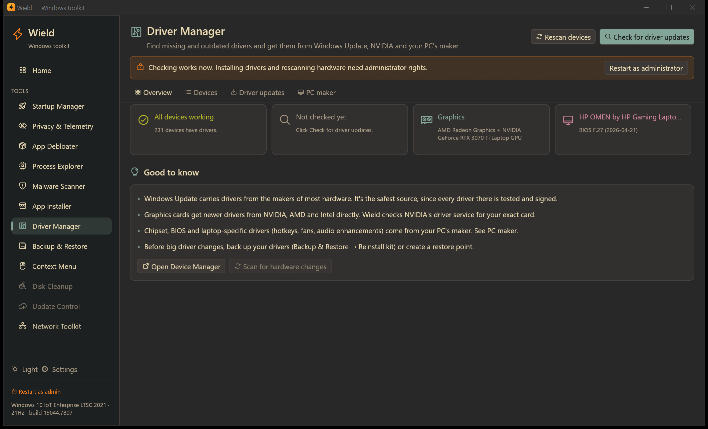
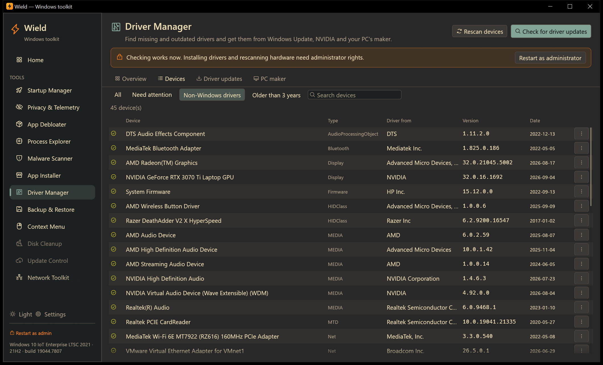
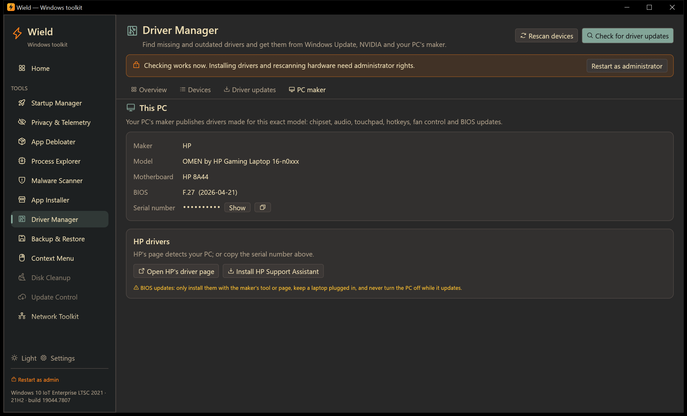

# Driver Manager

[← Manual](README.md)

Find devices without drivers, check for newer drivers, and install them from official sources only:

- **Windows Update**: where hardware makers publish their drivers;
- **NVIDIA's own driver service**;
- **your PC maker's** driver page and update tool.

There are no third-party "driver updater" databases.

Reading your devices works without administrator rights. Installing drivers and scanning for hardware changes need
them.

## Overview

Four cards sum up the PC. Click one to jump to its details.

| Card | Shows |
|---|---|
| **Devices** | "All devices working", or how many devices need attention and how many have no driver at all |
| **Updates** | "Not checked yet" until you click **Check for driver updates**, then how many updates were found |
| **Graphics** | Your graphics chips (for example *AMD Radeon Graphics + NVIDIA GeForce RTX 3070 Ti*) |
| **PC** | Maker, model and BIOS version |

**Check for driver updates** (top right) asks Windows Update and NVIDIA at the same time. It takes up to a minute,
and nothing is checked online until you click it.

Also on this tab:

- Devices that need attention are listed with the reason, for example *No driver installed (code 28)*.
- **Open Device Manager**.
- **Scan for hardware changes**: Windows detects new hardware and installs drivers it already has (administrator).
- **Rescan devices** (top) reads the device list again.

## Devices

Every device with its driver: **type**, **driver from** (the company that made the driver), **version** and
**date**. A red icon marks a problem; hover it for the reason.

Filters:

- **All**.
- **Need attention**: devices with a problem or no driver.
- **Non-Windows drivers**: drivers from hardware makers rather than Windows' built-in ones. These are the drivers
  you'd update.
- **Older than 3 years**: hardware-maker drivers that are getting old.
- **Search** by name, type, driver maker or hardware ID.

The **⋯** menu on each device offers:

| Action | What it does |
|---|---|
| **Check Windows Update** | Runs the driver update check |
| **Search the web for this hardware ID** | Searches for the device's exact ID (e.g. `VEN_10DE&DEV_24A0`), which identifies unknown devices reliably |
| **Install a driver from a folder…** | Installs every driver (`.inf`) in a folder you choose, for example an unpacked download from the maker or a [reinstall kit](backup.md#reinstall-kit) (administrator) |
| **Copy hardware ID** | Copies the ID for searching or support requests |
| **Open Device Manager** | Windows' own tool, for rolling back or uninstalling a driver |

Placeholder entries that need no driver (such as Bluetooth service nodes) are left out.

## Driver updates

### Graphics drivers

There's a card for each graphics chip:

- **NVIDIA:** Wield asks NVIDIA's driver service (the one the NVIDIA App uses) for the newest driver for your exact
  card, Windows version, and desktop or laptop.
  - It shows your installed version in NVIDIA's numbering (for example 616.92) and whether a newer one exists.
  - Choose **Game Ready** (for games) or **Studio** (tested with creative apps).
  - **Download and install** downloads NVIDIA's installer (about 700 MB) and checks it's digitally signed by NVIDIA
    before opening it. Then follow NVIDIA's installer; **Custom → Clean installation** resets NVIDIA's settings,
    which helps if you've had problems. The screen may flicker while it installs.
  - **Release notes** opens NVIDIA's page for that driver.
- **AMD:** AMD has no public driver lookup, so Wield shows the installed version and opens AMD's driver page, whose
  Auto-Detect tool installs the right driver.
- **Intel:** opens Intel Driver & Support Assistant, which keeps Intel graphics, Wi-Fi and Bluetooth drivers
  current.

On laptops that switch between two graphics chips, the PC maker's graphics drivers are tuned for that model. If the
newest generic driver causes problems, go back to the maker's version (see [PC maker](#pc-maker)).

### Windows Update drivers

Drivers that hardware makers publish through Windows Update for the devices in this PC, tested and signed by
Microsoft. After the check:

- each available driver is listed with its maker, type, date and size, all ticked;
- untick any you don't want and click **Install N selected** (administrator);
- progress shows in **Details**; a message says when Windows needs a restart to finish.

If a policy keeps drivers out of Windows Update, which is common on work PCs, a warning says so.
**Open Windows Update optional updates** opens the same list in Windows Settings.

Create a restore point first for peace of mind ([Backup & Restore → System Restore](backup.md#system-restore)).

## PC maker

Your PC's maker publishes drivers made for your exact model: chipset, audio, touchpad, hotkeys, fan control and BIOS
updates.

- **This PC** shows maker, model, motherboard, BIOS version and date, and the serial number. The serial is hidden;
  use **Show** or the copy button. Maker pages use it to find your model.
- **Open [maker]'s driver page**: the official support page. For Dell, it opens the driver list for your exact PC by
  its Service Tag.
- **Install [tool]**: the maker's official update app, installed through winget (see
  [App Installer](apps.md#if-winget-is-missing) if winget is missing):

  | Maker | Tool |
  |---|---|
  | HP | HP Support Assistant |
  | Dell | Dell Command \| Update |
  | Lenovo | Lenovo System Update |
  | ASUS | Armoury Crate |
  | MSI | MSI Center |

- Also recognized: Acer, Gigabyte, ASRock, Microsoft Surface, Samsung, Razer, Framework and virtual machines. For
  self-built PCs, the motherboard's maker is used.

Install BIOS updates only with the maker's tool or page, keep a laptop plugged in, and never turn the PC off while
it updates.

## A new PC or a fresh Windows install

1. Open Driver Manager. **Need attention** shows devices without drivers.
2. Click **Check for driver updates** and install what Windows Update offers. This usually covers most devices.
3. Install your graphics driver from the **Driver updates** tab.
4. Install your PC maker's tool from **PC maker** for chipset, BIOS and laptop features.
5. If something is still missing, use the device's **⋯ → Search the web for this hardware ID**, or **Install a driver
   from a folder…** with a driver you downloaded or a reinstall kit.
