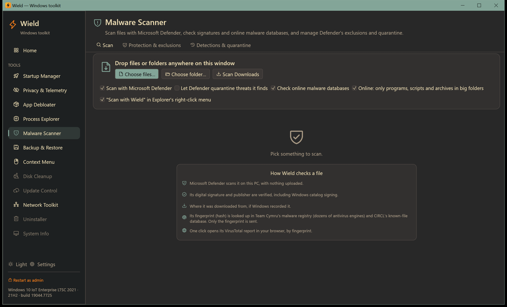
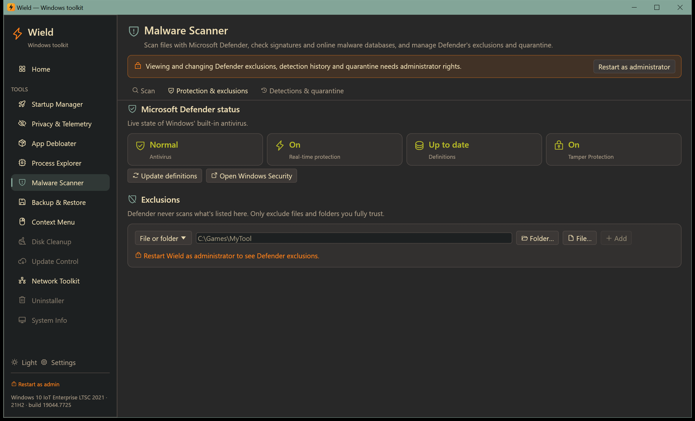
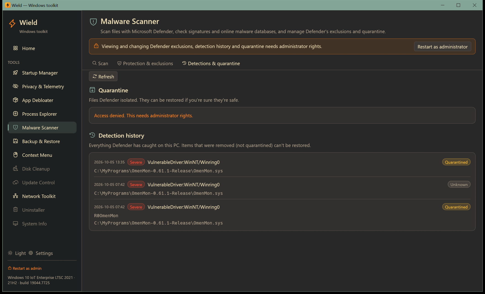

# Malware Scanner

[← Manual](README.md)

Check any file or folder for malware with Microsoft Defender, signature checks and online malware databases. Manage
Defender's exclusions and quarantine in the same place. No account or API key is needed.

## Scan tab

### Starting a scan

Any of these starts a scan:

- **Drag files or folders** anywhere onto the Wield window.
- Click **Choose files…**, **Choose folder…** or **Scan Downloads**.
- **Right-click a file in Explorer → Scan with Wield.** This entry is optional; turn it on in
  [Settings](settings.md#windows-integration) or in the installer.
- Run `wield.exe --scan <path>`.

### Options

| Option | Meaning |
|---|---|
| **Scan with Microsoft Defender** | Defender scans each file on this PC. Nothing is uploaded. |
| **Let Defender quarantine threats it finds** | Off by default, so Defender only reports. Tick it to let Defender isolate threats. |
| **Check online malware databases** | Sends only each file's fingerprint (SHA-1) to Team Cymru and CIRCL. File contents never leave the PC. |
| **Online: only programs, scripts and archives in big folders** | Keeps large folder scans fast |

### Results

Each file gets a verdict:

- **Threat**: Defender detected it, or malware databases list it.
- **Suspicious**: for example a broken signature, or many antivirus engines flag it.
- **No known threats**.
- **Trusted**: signed by a trusted publisher, or a known legitimate file.

Select a file to see why it got its verdict:

| Field | Meaning |
|---|---|
| **Signature** | Signed by whom, including Windows catalog signing, or not signed / broken |
| **Downloaded / From / Via page** | The website Windows recorded when the file was downloaded, and the zone (Internet, Untrusted site…) |
| **Defender** | Detection name, or "No detection" |
| **AV engines** | Team Cymru Malware Hash Registry: the percentage of antivirus engines that flag this file |
| **Known-file DB** | CIRCL hashlookup: known legitimate software, or known malicious |
| **SHA-256 / SHA-1** | The file's fingerprints, copyable |

Actions for the selected file:

- **Open on VirusTotal**: opens the file's report in your browser by fingerprint. Nothing is uploaded.
- **Upload to VirusTotal…**: warns that uploaded files are shared with security companies, then opens the upload
  page and shows the file in Explorer for you to drag onto the page.
- **Move to Recycle Bin**: you can restore it from the Recycle Bin. Files inside the Windows folder can't be deleted
  from Wield.
- **Exclude from Defender**: asks first, since Defender will never scan it again. Needs administrator rights.

## Protection & exclusions tab

- **Microsoft Defender status:**
  - antivirus state, real-time protection, definition age and Tamper Protection;
  - **Update definitions**;
  - a note when another antivirus is protecting the PC, which makes Defender passive.
- **Exclusions**: everything Defender skips. Add a file, folder, file type (extension) or process, or remove one.
  Only exclude things you fully trust.

## Detections & quarantine tab

- **Quarantine**: files Defender isolated.
  - **Restore** puts a file back. You can also tick **Also add an exclusion so Defender doesn't quarantine it
    again**.
  - Files Defender rates as high or severe need you to type `RESTORE`.
- **Detection history**: everything Defender has caught on this PC, with severity and outcome. Items Defender
  *removed*, rather than quarantined, can't be restored.

Exclusions, quarantine and detection history need administrator rights. On work PCs, policy or Tamper Protection
may block exclusions.
