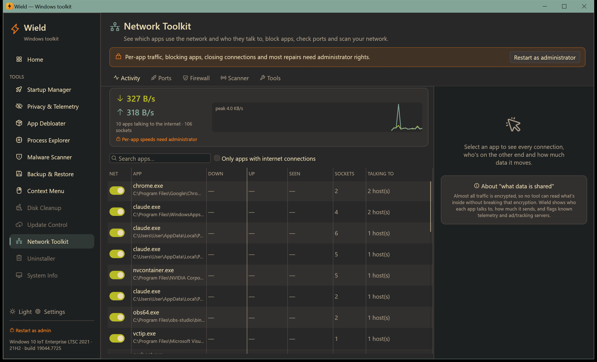
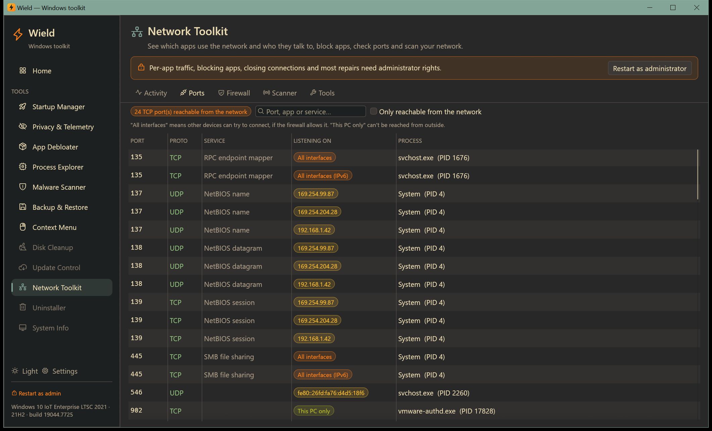
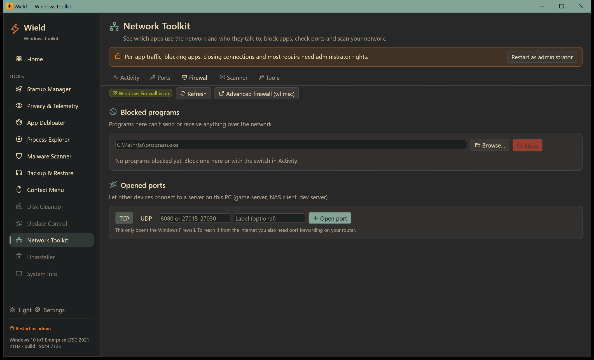
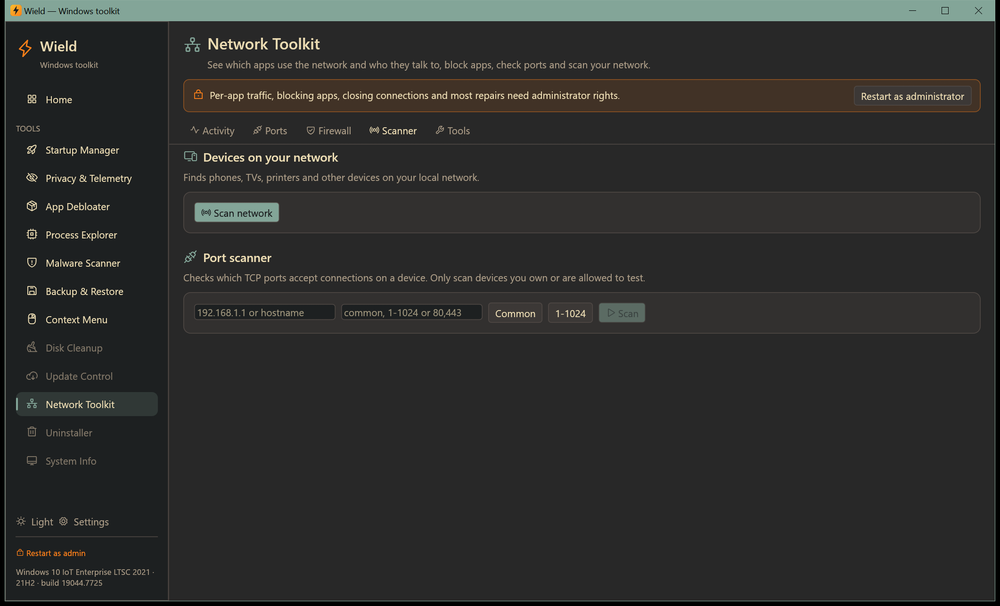
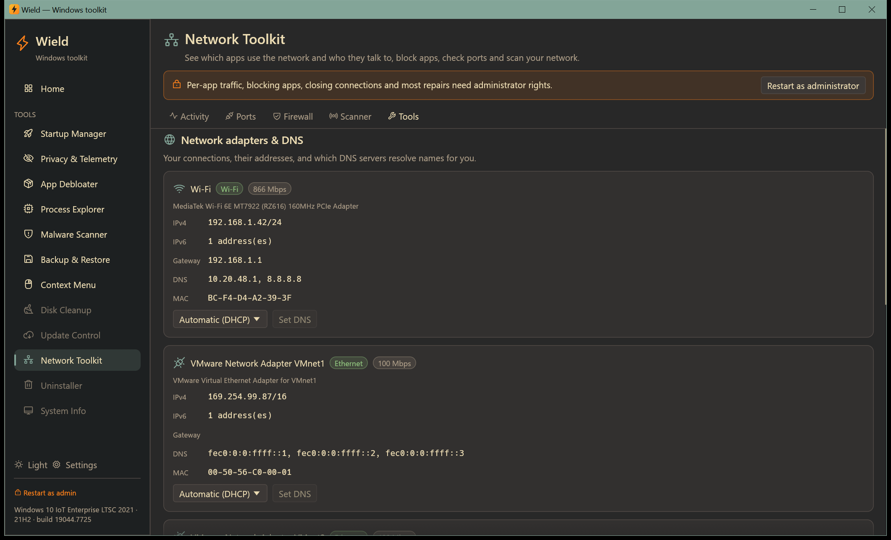

# Network Toolkit

[← Manual](README.md)

See which apps use the network and who they talk to, block apps, check ports, scan your network, and fix
connection problems.

Per-app traffic, blocking apps, opening ports, closing connections, changing DNS and most repairs need administrator
rights. If Windows Firewall is off for your current network, a banner warns that blocking and opening ports have no
effect.

## Activity

- **The graph at the top** shows the whole PC's download and upload speed.
- **The app list** shows every process with network sockets:
  - download and upload speed;
  - data moved since Wield started watching;
  - number of sockets;
  - who it's talking to.

  Tick **Only apps with internet connections** to hide apps that only talk locally. Speeds per app need
  administrator rights; they come from Windows' per-connection TCP statistics.
- **Select an app** to see each connection:
  - the remote host name (from the DNS cache, otherwise reverse DNS) and port/service;
  - the connection state and speed.

  Known **telemetry**, **ads/tracking** and **crash-report** servers are flagged. **Close** ends a single IPv4
  connection.
- **The switch** on each app blocks or allows its network access. Blocking creates a Windows Firewall rule for that
  program in both directions. New connections are refused immediately; restart the app to drop existing ones.
  Blocking Windows' own programs (such as `svchost.exe`) asks you to confirm first.

Wield can't show *what* is sent, because almost all traffic is encrypted. It shows *who* each app talks to and *how
much*.

## Ports

Every port a program is listening on:

- port, protocol (TCP/UDP) and service name;
- the owning process;
- **listening on**: *All interfaces* means other devices can reach it; *This PC only* means only this PC can.

Tick **Only reachable from the network** to see what's exposed. **Show in Activity** jumps to the process.

## Firewall

- **Blocked programs**: programs that can't send or receive anything.
  - Add any `.exe` by path or with **Browse…**.
  - The switch toggles each rule (on = blocked). Remove a rule to allow the program again.
- **Opened ports**: let other devices connect to a server on this PC, such as a game server or dev server.
  - Enter TCP or UDP, a port, a range (`8000-8100`) or a list (`80,443`), and an optional label.
  - Opening a port in Windows Firewall isn't enough to reach the PC from the internet; that also needs port
    forwarding on your router.

All rules are in the "Wield" group, so you can find them in Windows Defender Firewall (`wf.msc`).

## Scanner

- **Devices on your network**: finds phones, TVs, printers and other devices with a fast ping sweep plus the ARP
  cache. It shows:
  - IP address, name, MAC address and ping time;
  - which device is the router and which is this PC;
  - randomized private MAC addresses (typical of phones and laptops).
- **Port scanner**: checks which TCP ports accept connections on a device. Choose **Common** ports, **1-1024**, or
  your own list.

Only scan devices you own or are allowed to test.

## Tools

- **Network adapters & DNS**:
  - each adapter's addresses (IPv4/IPv6), gateway and DNS servers;
  - **Set DNS** per adapter: Automatic, Cloudflare, Cloudflare malware-blocking, Google, Quad9 or AdGuard.
- **Flush DNS cache**.
- **Public IP**: asks api.ipify.org, only when you click.
- **Ping**: checks whether a device or website answers, and how fast.
- **Block websites (hosts file)**: domains you add resolve to `0.0.0.0`, so no app on this PC can reach them.
  Remove them again from the list. The original hosts file is backed up the first time Wield edits it
  (`hosts.wield-backup`).
- **Repair**, for when the connection misbehaves:

  | Repair | What it does |
  |---|---|
  | **Renew IP address** | Requests a new address from the router; drops connections for a few seconds |
  | **Clear ARP cache** | Forgets cached device addresses on your local network |
  | **Reset Winsock** | Fixes broken network settings left by VPNs or security software; restart Windows afterwards |
  | **Reset TCP/IP stack** | Resets Windows' network configuration; restart Windows afterwards |
