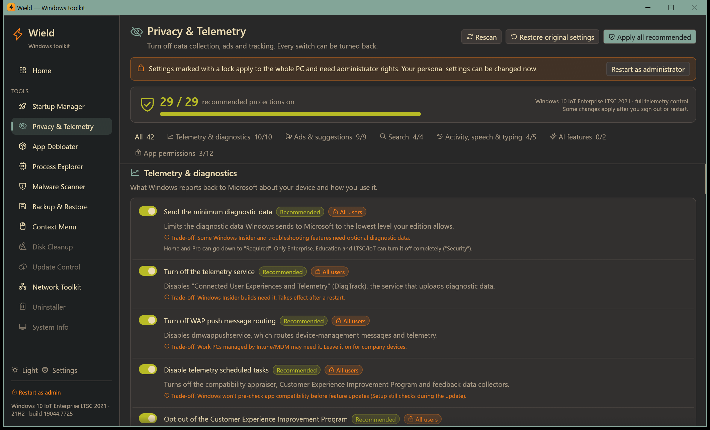

# Privacy & Telemetry

[← Manual](README.md)

Turn off data collection, advertising and tracking with one switch per setting. Every setting explains what it does
and what you give up, and everything can be put back exactly as it was.

## The settings

There are 42 settings in six groups. Use the group buttons at the top to show one group, or **All**:

| Group | Examples |
|---|---|
| **Telemetry & diagnostics** | Diagnostic data level, the DiagTrack and dmwappushservice services, telemetry tasks, Customer Experience Improvement Program, app telemetry, Error Reporting, feedback prompts, tailored experiences |
| **Ads & suggestions** | Advertising ID, automatically installed promoted apps, tips, Settings and lock screen promotions, welcome pages after updates, File Explorer sync ads |
| **Search** | Bing web results in Start, search highlights, cloud content search, Cortana |
| **Activity, speech & typing** | Activity history, cross-device clipboard, online speech recognition, inking & typing personalization, app launch tracking |
| **AI features** | Recall snapshots (Copilot+ PCs on 24H2 and later) and Windows Copilot |
| **App permissions** | Stop Store apps from using account info, diagnostics, location, camera, microphone, notifications, contacts, calendar, call history, email, messages and radios |

Each setting shows:

- a short explanation and what you give up by turning it on;
- a **Recommended** badge on the 29 settings that are safe for most people;
- a **lock** icon if it applies to the whole PC (needs administrator rights);
- **Partly applied** when only some of its values are set (click to apply fully);
- **Not available** when your Windows edition or build doesn't have it.

## Using it

- **The switch** turns a protection on. Turning it off again restores the Windows default.
- **Privacy score** (top) counts how many recommended protections are on.
- **Apply all recommended** lists every setting it will change, then applies them in one go. PC-wide settings are
  skipped (and listed) if you're not an administrator.
- **Restore original settings** puts back every value Wield changed, exactly as it was before Wield first touched
  it. This undoes every protection you applied with Wield.
- **Rescan** reads the current state again, for example after you changed something in Windows Settings.

Wield adapts to your edition. For example, diagnostic data is set to *Security* (the minimum) on Enterprise,
Education and LTSC, and to *Required* on Home and Pro, where *Security* isn't supported.

## Where the originals are saved

The first time Wield changes a value, it saves the original to `%LOCALAPPDATA%\Wield\privacy-backup.json`.
**Restore original settings** uses this file. Keep it if you plan to reinstall Wield later.

## Notes

- Some changes take effect after you sign out or restart, especially services and policies.
- Windows feature updates sometimes turn settings back on. Open the tool after a big update and use
  **Apply all recommended** again.
- On work PCs, Group Policy may override these settings.
