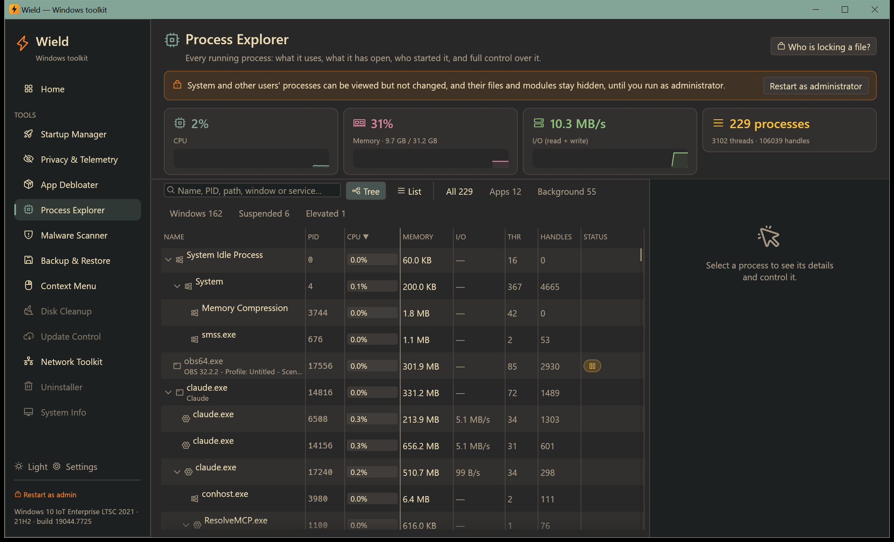

# Process Explorer

[← Manual](README.md)

A Task Manager replacement that shows more: every process, what it uses, what it has open, who started it, and full
control over it.

## The process list

- **Graphs at the top** show the whole PC's CPU, memory and disk I/O (read + write) over the last two minutes.
- **Tree or list.** The tree shows which process started which. The list can be sorted by any column.
- **Columns:** name, PID, CPU %, private memory, I/O rate, threads, handles and status (suspended, efficiency mode,
  elevated).
- **Filters:**
  - **Apps**: programs with windows;
  - **Background**;
  - **Windows**: parts of Windows;
  - **Suspended**;
  - **Elevated**: running as administrator.
- **Search** by name, PID, path, window title or the service a `svchost.exe` hosts.

Protected system processes that can't be opened still show their memory, CPU time, threads, handles and I/O.

## Details

Select a process to open its details. The tabs show:

- **Overview:**
  - full path and digital signature (publisher, including Windows catalog signing);
  - command line, and the parent and child processes;
  - start time, running time and total CPU time;
  - user, integrity level, elevation, 32/64-bit, session and priority;
  - threads and handles, and the services hosted (for `svchost.exe`).
- **Performance:**
  - CPU and memory graphs for this process;
  - memory breakdown: private memory, working set, peaks, page faults and kernel pools;
  - I/O totals and current I/O.
- **Open files:** every file and folder the process has open. Filter the list, or show a file in Explorer.
- **Modules:** loaded DLLs. Non-Windows DLLs are highlighted, which helps spot injected or unusual code.
- **Network:** the process's open connections and listening ports.

Wield marks processes you shouldn't touch:

- **Critical: ending it crashes Windows.** Wield refuses to end these.
- **Part of Windows.** Ending it can sign you out, freeze the desktop or stop features until you restart. Wield asks
  you to confirm.
- **This is Wield itself.**

## Controlling a process

| Button | What it does |
|---|---|
| **End task** | Closes the process. Unsaved work in it is lost. |
| **End process tree** | Closes the process and every process it started |
| **Suspend / Resume** | Freezes the process: it uses no CPU until resumed. Suspending Windows processes can freeze the desktop. |
| **Efficiency mode** | Sends it to the background: lowest priority plus power throttling, like Task Manager on Windows 11. This works on Windows 10 too. |
| **Priority** | Sets its CPU priority |
| **CPU affinity** | Chooses which logical processors it may run on |
| **Restart** | Ends it and starts it again with the same command line |
| **Open file location** | Shows the program in Explorer |
| **Scan with Malware Scanner** | Opens the [Malware Scanner](malware.md) on this program |
| **Block its network access** | Adds a firewall rule (see [Network Toolkit](network.md#firewall)) |
| **Search online** / **Copy command line** | Look the process up on the web, or copy its full command |

Processes of other users and system processes can be viewed but not changed until you run Wield as administrator.
Their open files and modules stay hidden until then.

## Who is locking a file?

When Windows says a file or folder is "in use by another program":

1. Click **Who is locking a file?**.
2. Choose the file (**Choose a locked file**) or folder (**Choose a folder**).
3. Wield lists every process holding it, using Windows' Restart Manager.
4. **Show** selects the process in the list, or end it right there.
