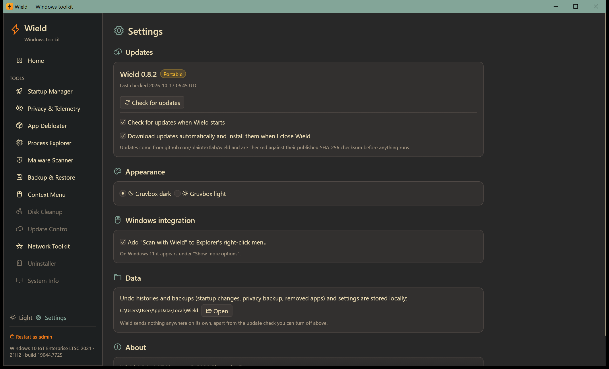

# Settings and updates

[← Manual](README.md)

Open **Settings** from the bottom of the sidebar.

## Updates

Wield gets new versions from [GitHub Releases](https://github.com/plaintextlab/wield/releases).

- The top line shows your version, whether this copy is **Installed** or **Portable**, and when Wield last
  checked. **Check for updates** checks right now.
- **Check for updates when Wield starts**: checks at most every 12 hours. Turn it off and Wield never contacts
  GitHub on its own.
- **Download updates automatically and install them when I close Wield**: updates download in the background and
  install the next time you close Wield.
- When an update is available, the sidebar shows **Update to vX.Y.Z**, and Settings shows:
  - **Update now**: downloads, verifies, installs and reopens Wield;
  - **Install when I close Wield**;
  - **Skip this version**: no more reminders for that release.

Every download is checked against the SHA-256 checksum published with the release before anything runs.

- **Installed** copies update by running the new installer silently.
- **Portable** copies replace their own `.exe`; the old one is kept as `.exe.old` until the next start.

## Appearance

Switch between the Gruvbox **dark** and **light** themes. The sun/moon button at the bottom of the sidebar does the
same.

## Windows integration

**Add "Scan with Wield" to Explorer's right-click menu** lets you right-click any file or folder and scan it with
the [Malware Scanner](malware.md). It's added for your account only. On Windows 11 it appears under
**Show more options**.

## Data

Shows the folder where Wield keeps undo histories, backups and settings (`%LOCALAPPDATA%\Wield`), with a button to
open it. See [Where Wield keeps its data](README.md#where-wield-keeps-its-data) for what each file is.

Wield sends nothing anywhere on its own, apart from the update check you can turn off.

## About

Version, license (MIT), and links to the source code, to report a problem and to all releases.
