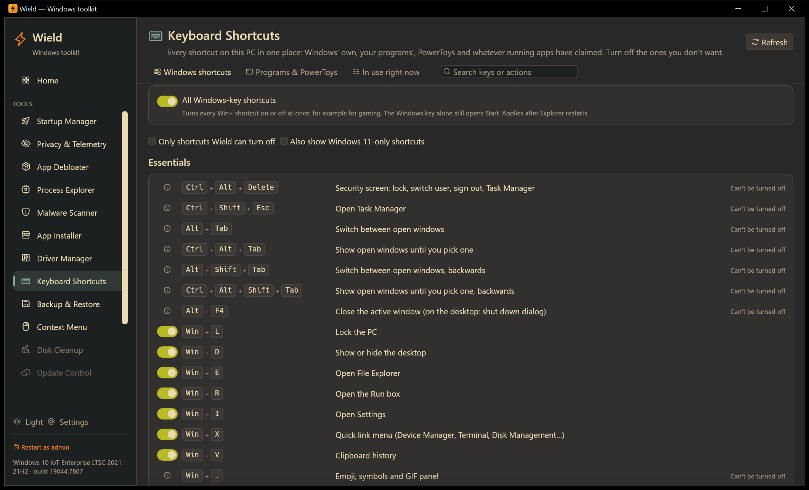
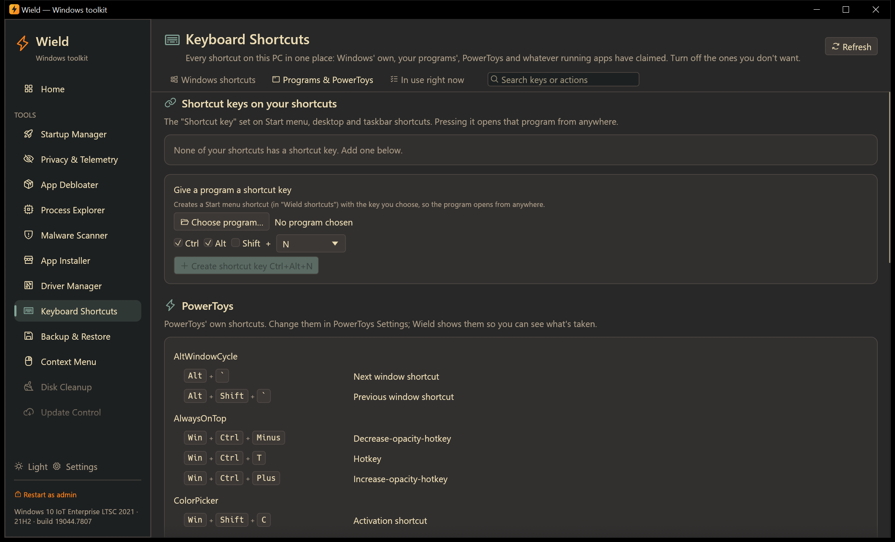
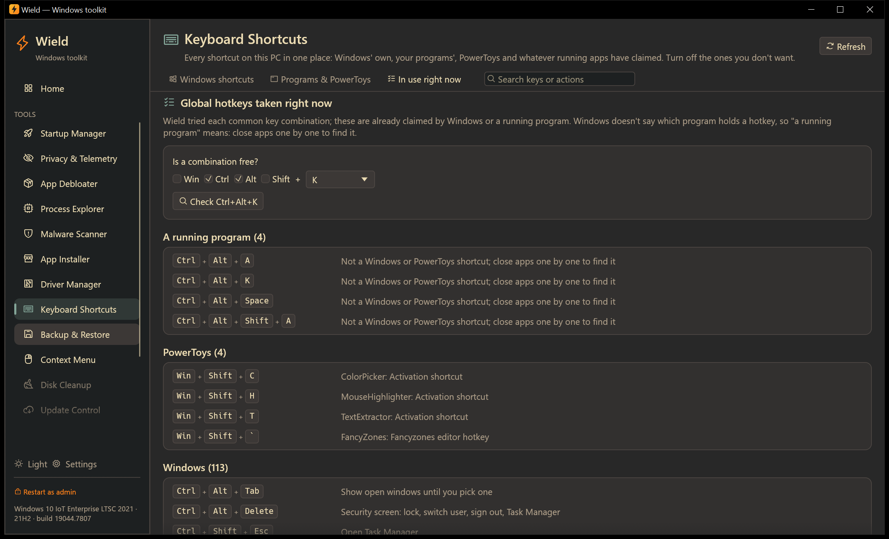

# Keyboard Shortcuts

[← Manual](README.md)

Every keyboard shortcut on the PC in one place:

- Windows' own;
- shortcut keys set on your programs' shortcuts;
- PowerToys;
- global hotkeys that running apps have claimed.

Turn off the ones you don't want, give programs their own keys, and find out what's using a key combination.
Everything here works without administrator rights, except changing shortcuts installed for all users.

## Windows shortcuts

About 120 of Windows' shortcuts, in groups:

- Essentials;
- Windows key;
- Windows, snapping & desktops;
- Screenshots & recording;
- Accessibility;
- Language & input;
- File Explorer;
- Taskbar & Start;
- Text editing.

Each row shows the keys, what they do, and a badge for shortcuts that exist only in Windows 10 or only in Windows 11.

- **A switch** means Wield can turn the shortcut off and on again. Hover it to see when the change applies.
- **ⓘ "Can't be turned off"** means Windows has no setting for it. Hover the icon for the reason and what you can do
  instead. Often that's PowerToys Keyboard Manager, which can remap almost any key.

### What can be switched off

| Shortcut | How Wield turns it off | Applies |
|---|---|---|
| **All Windows-key shortcuts** (card at the top) | Windows' own policy setting. The Windows key alone still opens Start. | After Explorer restarts |
| **Win+letter / Win+number** (Win+E, Win+R, Win+D, Win+G, Win+1…) | Explorer's list of ignored Win+ keys. Turning off a letter turns off every Win+ combination with it, so Win+S also turns off Win+Shift+S. | After Explorer restarts |
| **Win+L** (lock) | Windows' setting that removes locking. The Lock option on Ctrl+Alt+Del goes too. | Right away |
| **Win+arrows** (snap, maximize) | Snap windows on or off. This also affects dragging windows to the screen edges. | Right away |
| **Win+Home** (minimize others) | Turns off "shake" minimizing | After Explorer restarts |
| **Print Screen** opens snipping | Off: Print Screen copies the screen to the clipboard, the classic way | After signing out |
| **Shift five times**, **hold Right Shift**, **hold Num Lock**, **Left Alt+Left Shift+PrtScn**, **Left Alt+Left Shift+Num Lock** | Accessibility shortcuts for Sticky Keys, Filter Keys, Toggle Keys, high contrast and Mouse Keys. Turning one off only removes the shortcut; the feature stays available in Settings. | Right away |
| **Win+Ctrl+C** (color filters), **Win+Ctrl+Enter** (Narrator) | Their accessibility shortcut settings | Right away |
| **Left Alt+Shift** (input language), **Ctrl+Shift** (keyboard layout) | Windows' language hotkey settings. Only matters with more than one language or layout. | After signing out |

When a change needs Explorer restarted, a banner offers **Restart Explorer now**. Open Explorer windows close and
the taskbar reloads for a moment.

After a restart Wield checks again. If a Win+ shortcut you turned off is still taken, it's marked **Still active**:
another part of Windows handles that one, so the Explorer setting doesn't reach it.

Options above the list:

- **Only shortcuts Wield can turn off** hides the rest.
- **Also show Windows 10-only / 11-only shortcuts** shows shortcuts from the other Windows version.

## Programs & PowerToys

### Shortcut keys on your shortcuts

Any Start menu, desktop or taskbar shortcut can have a **shortcut key** (its Properties → Shortcut key) that opens
the program from anywhere. Wield lists every one it finds:

- **The switch** turns the key off. Wield remembers it, so switching it back on restores it.
- **Change** picks a different key. Wield warns if the new combination is already used, and by what.
- 📁 shows the shortcut file in Explorer.

Shortcuts installed for all users are marked **All users**; changing them needs administrator rights.

### Give a program a shortcut key

1. **Choose program…** and pick the program's `.exe`.
2. Pick the modifiers and the key. Windows requires **Ctrl+Alt**, **Ctrl+Shift** or **Ctrl+Alt+Shift** plus a
   key, or an F-key on its own, so the shortcut never gets in the way of typing.
3. Wield warns if the combination is taken.
4. **Create shortcut key** adds a Start menu shortcut in a folder called **Wield shortcuts** with that key.
   Pressing it opens the program from anywhere. Delete the shortcut to remove the key.

### PowerToys

If PowerToys is installed, every PowerToys shortcut is listed by module, marked **Module off** where that PowerToys
tool is turned off. Keyboard Manager remaps are listed as *from → to*. Change these in PowerToys Settings;
Wield shows them so you know which combinations are taken.

### Other apps

Default global hotkeys of popular apps that are running now:

- the NVIDIA and AMD overlays;
- ShareX, Greenshot, Lightshot and Snagit;
- Flow Launcher, Windows Terminal, Ditto and f.lux.

**Active** means the app really holds that hotkey right now. Change them in each app's own settings.

Shortcuts that only work inside an app (like Ctrl+S) aren't global and aren't listed. Each app shows them in its menus
or help.

## In use right now

Wield tries about 550 common key combinations (Ctrl+Alt+…, Ctrl+Shift+…, Win+…, F-keys…) and lists the ones that are
already taken, grouped by who holds them:

| Group | Meaning |
|---|---|
| **A running program** | Taken, but not by Windows or PowerToys. Windows doesn't reveal which program holds a hotkey; close apps one at a time and press **Refresh** to find it. |
| **Apps** | A known app's default hotkey, with that app running |
| **PowerToys** | A PowerToys shortcut |
| **Your shortcuts** | A shortcut key you set on a program's shortcut |
| **Windows** | Windows' own; Win+ combinations Wield doesn't know are probably Windows features (Game Bar, Snipping…) |

**Is a combination free?** checks any combination instantly. Use it before you pick a new hotkey in an app.

F12 on its own always shows as taken: Windows reserves it for debuggers.

## Tips

- If a game keeps opening Game Bar or Start, turn off **All Windows-key shortcuts** while gaming, then turn it back on.
- If a hotkey in an app suddenly stops working, another program probably took it. Check **In use right now**.
- The **Search** box at the top searches all three tabs, by keys (`Win+G`) or by action (`screenshot`).
