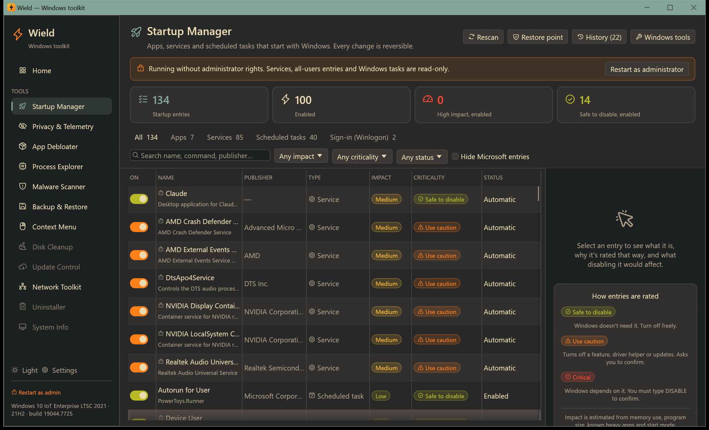

# Startup Manager

[← Manual](README.md)

Everything that starts with Windows, in one list: apps, services, scheduled tasks and sign-in components. Turn
things off to make Windows start faster and use less memory. Every change can be undone.

## What it finds

| Type | Where Windows keeps it |
|---|---|
| **Apps** | The registry `Run` keys (yours and all users', 64- and 32-bit), `RunOnce` and policy `Run` keys (read-only), and both Startup folders (shortcut targets are resolved) |
| **Services** | Every service set to start *Automatic*, including delayed start. For services hosted in `svchost.exe` the real DLL is shown. |
| **Scheduled tasks** | Every task that runs *at startup* or *at log on* |
| **Sign-in (Winlogon)** | `Shell`, `Userinit` and `AppInit_DLLs`. These are read-only and flagged when they differ from the Windows defaults, which is a common sign of malware. |

## Reading the list

Each row shows:

- **Name** and **Publisher** (from the program's digital signature or version information).
- **Type**: app, service, task or sign-in.
- **Impact**: High, Medium or Low. Wield estimates this from current memory use, program size, known heavy apps
  and how the entry starts. Windows doesn't expose its own startup-impact measurement to other programs.
- **Criticality**: what breaks if you turn it off.
  - 🟢 **Safe to disable**: Windows doesn't need it. Turns off with one click.
  - 🟠 **Use caution**: turns off a Windows feature, a hardware helper (GPU, audio, touchpad) or updates. You tick a
    confirmation box first.
  - 🔴 **Critical**: Windows depends on it (RPC, DHCP, DNS, audio, sign-in, Defender…). You must type `DISABLE`.

  Ratings come from a built-in knowledge base of about 150 services, Windows task folders and common apps, then
  from vendor rules. Entries whose program no longer exists are flagged as **leftovers**: safe to remove.
- **Status**: the switch. Green means enabled. **Modified** marks entries you changed with Wield.

Click a row to see the details panel on the right:

- what the entry is and why it's rated that way;
- publisher, program path, file size and memory in use now;
- where it's registered;
- the full command (with a copy button).

## Filtering

Use the boxes above the list:

- **Quick filters:**
  - **Everything Wield found**;
  - **Enabled**;
  - **High impact, enabled**: the best candidates for a faster start;
  - **Safe to disable, enabled**: entries you can turn off without worry.
- **Type tabs:** Apps, Services, Scheduled tasks, Sign-in.
- **Dropdowns:** impact, criticality and status.
- **Hide Microsoft entries:** shows only third-party software.
- **Search box:** searches names, publishers and commands.

## Turning things off and on

Click the switch.

- **Apps and Startup-folder items** are disabled the same way Task Manager does it: a flag in the registry, with
  nothing deleted.
- **Services** ask how they should start from now on:
  - **Manual** (recommended): the service starts only when another program needs it.
  - **Disabled**: it never starts, even when needed. This can break things that depend on it.
- **Scheduled tasks** have their *Enabled* setting turned off.

Machine-wide entries (services, all-users apps, most tasks) need administrator rights. Without them they're
read-only, and the banner offers **Restart as administrator**.

## Undo and safety

- **Undo previous changes** (top right) opens the change history. Every change is listed with the time, and
  **Revert** puts that entry back exactly as it was. The history is saved in
  `%LOCALAPPDATA%\Wield\startup-journal.json`.
- **Restore point** creates a System Restore point before you make risky changes. Windows allows one automatic point
  per 24 hours; [Backup & Restore](backup.md#system-restore) can create one at any time.
- The **links at the top** open Windows' own tools: Services (`services.msc`), Task Scheduler, Task Manager and your
  Startup folder.

## Tips

- Disable a few high-impact entries, restart, and check everything still works before doing more.
- Updaters (Adobe, Google, Java…) are usually safe to disable; the app still updates when you open it.
- Don't disable security software, drivers' control panels you use, or anything rated red unless you know why.
