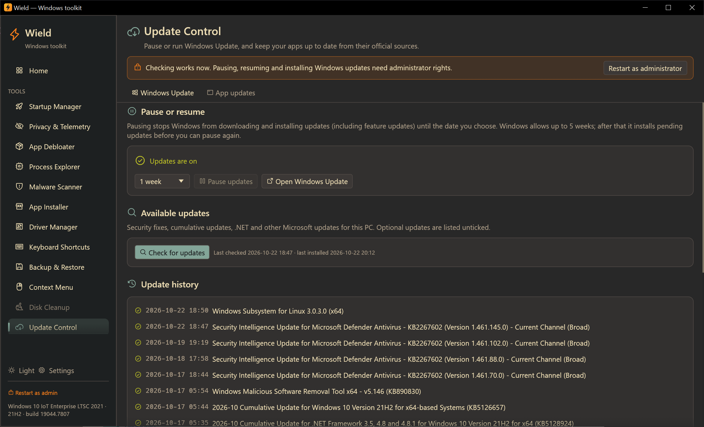
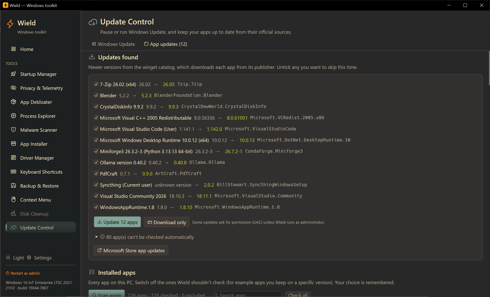

# Update Control

[← Manual](README.md)

Control Windows Update and keep your installed apps up to date, from their official sources.

## Windows Update

Checking works without administrator rights; pausing, resuming and installing need them.

### Pause or resume

- **Updates are on** or **Updates are paused until …** shows the current state.
- Choose **1 to 5 weeks** and click **Pause updates**. Windows stops downloading and installing all updates,
  including feature updates, until that date. Wield uses the same settings as the Pause button in Windows Settings,
  so Settings shows the pause too.
- **Resume updates** ends the pause; Windows checks for updates soon after.
- Windows allows at most 5 weeks. When a pause ends, Windows installs pending updates before you can pause again.
- If another tool has disabled the Windows Update service, a red badge says so. Updates can't run until the service
  is set back to Manual.

### Available updates

1. Click **Check for updates**. Wield asks Windows Update directly, which takes up to a minute.
2. Every update this PC doesn't have is listed:
   - security fixes, cumulative updates, .NET and other Microsoft updates;
   - each with its severity (Critical, Important…), category and size.

   Optional updates are listed but unticked.
3. Untick any you don't want and click **Install N selected**. Progress shows in **Details**, and a message says when
   Windows needs a restart to finish.

**Last checked** and **last installed** show when Windows last did each.
**Open Windows Update** opens the same page in Windows Settings.

Driver updates are in the [Driver Manager](drivers.md#windows-update-drivers).

### Update history

The last 25 updates, with the date and whether each installed successfully (✓), failed (✗) or was cancelled.

## App updates

App updates use the Windows Package Manager (winget). It knows thousands of apps and downloads each update from the
publisher. If winget is missing (normal on LTSC), click **Install winget** in the banner; see
[App Installer](apps.md#if-winget-is-missing).

### 1. Choose which apps to check

**Installed apps** lists every app on the PC with its version and publisher. Each has a switch:

- **On** (default): checked for updates.
- **Off**: never checked, and never offered as an update. Use this for apps you keep on a specific version, or apps
  that manage their own updates.

Wield remembers your choices. Matching ignores version numbers in app names, so "7-Zip 26.02" stays excluded after
it becomes "7-Zip 26.05". **Search apps** filters the list; **Check all** turns every switch back on.

### 2. Scan for updates

Click **Scan for updates**. Wield asks winget which of your apps have newer versions, which takes 5–30 seconds.

**Updates found** lists each app with its current version → new version and its winget ID, ticked. Excluded apps
never appear here.

**N apps can't be checked automatically** (expand it) lists apps that aren't in winget's catalog: drivers, games from
launchers, company software and the like. Most of these update themselves or through their launcher.

**Microsoft Store app updates** opens the Store's own update page for Store apps.

### 3. Update or download

- **Update N apps** downloads and installs each ticked update silently, one after another.
  - Close the apps first for the smoothest update.
  - Some installers ask for permission (UAC) unless Wield runs as administrator.
  - **Stop after this one** ends the queue cleanly.
- **Download only** saves the installers to `Downloads\Wield updates` without installing them, for example to
  install later or on another PC. **Open folder** shows them.

Each app ends as one of the following:

- **Updated to …**;
- **Already up to date**;
- **Updated; restart Windows to finish**;
- **Downloaded**;
- an error with the reason.

Updated apps drop off the list. **Log** opens the full output, saved in `%LOCALAPPDATA%\Wield\app-installs\`.
